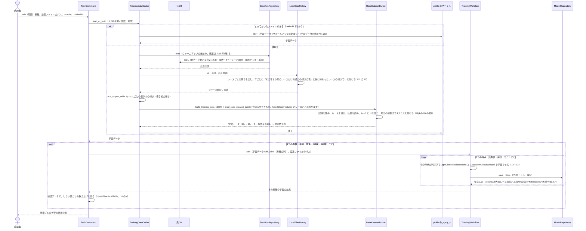
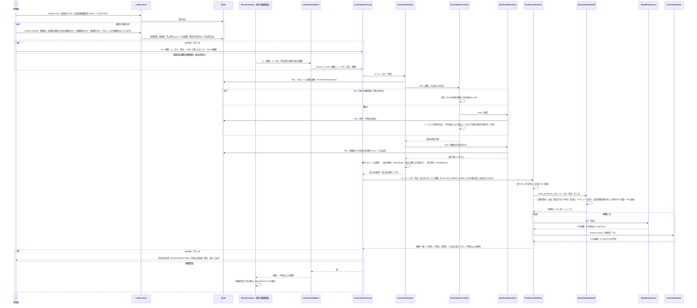

# 05 学習と予測のやりとり（シーケンス図）

**この文書で示すこと:** 学習と予測のとき、利用者・nvdata-store・元DB と、[04-classes.md](04-classes.md) のクラスが、どの順に、どのメソッドを呼ぶか。

**結論: 流れは「学習」と「予測」の2つに分かれる。** 学習は `TrainCommand` が `TrainingDataCache` に学習データを1回作らせ（2回目からは読むだけ）、券種ごとに共通の `TrainingWorkflow` を回して、3つの時点ごとに多クラス分類の LightGBM と CatBoost を学習させて保存する。予測は `LocalUpsetForecast` が進め、まずそのレースの当日の馬場傾向のレースの値（U）を出し、それを渡した `RaceDatasetBuilder` と中央の `PredictionWorkflow` で券種ごとの4つの確率を出す。中央の荒れ具合の予想と違うのは、学習データに U を付けてとっておくこと、予測の前に U を出すこと、推奨買目から呼ばれることである。

- 図に出てくるものと図の読み方（凡例）は [地方の全頭の予想の 05 の「図に出てくるもの」](../地方競馬の近走と適性から3着以内を予想/05-sequence.md#図に出てくるもの) と [手本の 05 の「図の読み方」](../近走と適性から3着以内を予想/05-sequence.md#図の読み方) を参照。この予想で増えるのは、`TrainingDataCache`・`LocalBiasHistory`・`RaceUsedSlopes`・`PriorSlopeYearStore`・`LocalUpsetForecast`・`UpsetProbabilities`（道具「地方の推奨買目」）である。
- 1頭ごとの特徴量をレース単位に集約するやりとり、記録を集めるやりとり、予測に使うオッズの決め方は中央と同じで、[中央の荒れ具合の 05 の図3](../レースの荒れ具合を4段階で予想/05-sequence.md#図3-1頭ごとの特徴量をレース単位に集約する)・[手本の 05 の図3・図4](../近走と適性から3着以内を予想/05-sequence.md#図3-記録を集めるリポジトリとのやりとり)・[手本の 06 の図2](../近走と適性から3着以内を予想/06-flowchart.md#図2-予測に使うオッズの決め方) を参照。
- public メソッドの中の判断（if 文による分かれ道）は [06-flowchart.md](06-flowchart.md) を参照。2種類の図の使い分けは [01-overview.md](01-overview.md#図の使い分け) を参照。

## 図1. 学習

**説明。** 利用者が `train` を実行する。`TrainCommand` は、まず `TrainingDataCache` に学習データを求める。とっておいたファイルがあればそれを読み、無ければ元DB から作る。作るときは、地方・平地の全出走を読み（`BiasRunRepository`）、`LocalBiasHistory` でリークを防ぐ決まり（年ごとの過去の傾きの表と、先に終わったレースの傾き）で U を付け、レースごとの使う傾きの表（`race_slopes_table`）にして `UsedSlopeFeatures` に渡す。学習データそのものは、中央の荒れ具合の予想と同じ `RaceDatasetBuilder` が作る（1頭ごとの記録を集める → レースを選ぶ → 払戻を読む → レース単位の特徴量 51個 → 地方の線引きで荒れ具合 4列）。元DB を開くのはこの段だけで、学習のあいだはロックを持たない。

学習は券種ごとに共通の `TrainingWorkflow` を1回ずつ回す（中央と同じ。多クラス用のモデルの並び `CLASS_MEMBER_TYPES` と評価 `ClassModelEvaluator` を渡す）。出馬表・前日のモデルには、その時点で使う列だけを渡す（[07-prediction-timing.md](07-prediction-timing.md#時点ごとに使う特徴量)）。U は当日から分かる列なので、当日のモデルだけに渡る。

## 図2. 予測

発走前（か終わったあと）に、1レースの券種ごとの荒れ具合を出すときの流れ。`predict` コマンドと、道具「地方の推奨買目」の両方が `LocalUpsetForecast` を呼ぶ。

**説明。** 利用者（か発走前の通知）は、まず nvdata-store で出馬表と速報を取り込む。当日の速報 0B15 には、その日に先に終わったレースの結果（着順・4コーナーの順位）が入るので、取り込んでおくと当日の馬場傾向にその日のレースが数えられる（取り込んでいなければ、前の日のレースと過去の傾きだけで出す）。

`LocalUpsetForecast.run()` は、まず `RaceUsedSlopes` にそのレースの U のレースの値を出させる。過去の傾きの表は `PriorSlopeYearStore` が年ごとにとっておいたもの（その年の1月1日より前のレースだけで作る。学習データと同じ決めごと）、当日の傾きは開催日とその前の日の終わったレースの傾きだけを毎回数える（2日ぶんなので速い）。次に、その1行の表を `UsedSlopeFeatures` に渡して組み立てた `RaceDatasetBuilder` と、中央と同じ `PredictionWorkflow` で予測する。オッズの決め方・記録の集め方・要る情報の確かめ方・券種ごとのモデルの読み方は中央の荒れ具合の予想と同じである。

道具「地方の推奨買目」の `Recommender` は、荒れ具合の条件のある券種（3連複）があるときだけ、`UpsetProbabilities` を通して `upset_or_more()` を当日の時点で呼ぶ。モデルが無い・馬体重がまだ無い、などで出せなければ、`Recommender` は 3連複だけを対象外にして理由を添える（[06-flowchart.md の図1](06-flowchart.md#図1-推奨買目が-3連複を買うかどうかの判断)）。

## 文書情報

| 項目 | 内容 |
|---|---|
| 作成日 | 2026-11-06 |
