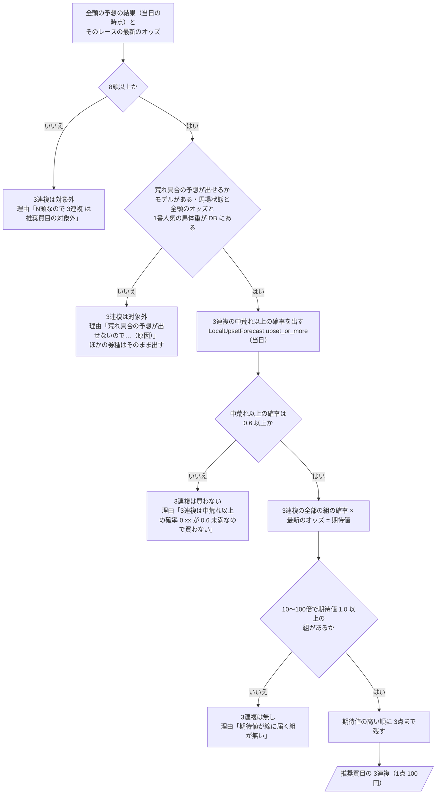

# 06 判断の手順（フローチャート）

**この文書で示すこと:** 学習データを作るとき・予測するとき・推奨買目がこの予想を使うときの、条件によって分かれる判断の手順。

**結論: 学習データに入れるレースの選び方と4クラスの付け方、予測に要る情報の確かめ方、予測に使うオッズの決め方は、中央の荒れ具合の予想と同じ手順で、描き直さない。この予想で増える判断は「推奨買目が 3連複を買うかどうか」（図1）である。**

- この文書は、1つの public メソッドの中で、条件で分かれる判断の手順を示す。クラスどうしのやりとりは [05-sequence.md](05-sequence.md) を参照。2種類の図の使い分けは [01-overview.md](01-overview.md#図の使い分け) を参照。
- 図の読み方（凡例）は [手本の 06 の「図の読み方」](../近走と適性から3着以内を予想/06-flowchart.md#図の読み方) を参照。四角が作業、ひし形が if 文1つ、平行四辺形ができあがるものである。
- 学習データに入れるレースの選び方と4クラスの付け方（`RaceSelector.training_samples()`・`UpsetLevelLabeler.build()`）は [中央の荒れ具合の 06 の図1](../レースの荒れ具合を4段階で予想/06-flowchart.md#図1-学習データに入れるレースの選び方と4クラスの付け方) と同じ。違いは、線引きの額が地方のもの（[10-target.md](10-target.md#券種ごとの線引き)）で、学習データの始まりの既定が 2019年1月1日であることだけ。
- 予測に要る情報の確かめ方（`RequiredInfoCheck.check()`。前日以降は馬場状態と全頭の単勝オッズ、当日は1番人気の馬体重）は [中央の荒れ具合の 06 の図2](../レースの荒れ具合を4段階で予想/06-flowchart.md#図2-予測に要る情報の確かめ方) と同じ。違いは、案内する取り込みの道具が `nvstore realtime` であることだけ。
- 予測に使うオッズの決め方（`OddsResolver.resolve()`）は [手本の 06 の図2](../近走と適性から3着以内を予想/06-flowchart.md#図2-予測に使うオッズの決め方) と同じ。
- モデルごとの判断の手順（カテゴリ特徴量の値の変え方）は、[中央の荒れ具合の 12](../レースの荒れ具合を4段階で予想/12-lightgbm.md#3-カテゴリ特徴量の値の変え方フローチャート)・[13](../レースの荒れ具合を4段階で予想/13-catboost.md#3-カテゴリ特徴量の値の変え方フローチャート) を参照。
- 用語の意味は [02-glossary.md](02-glossary.md) を参照。

## 図1. 推奨買目が 3連複を買うかどうかの判断

道具「地方の推奨買目」の `Recommender.recommend()` の中で、3連複の買い方（`TicketPlan`。10〜100倍・期待値 1.0 以上・8頭以上・期待値の上位 3点・3連複の中荒れ以上の確率 0.6 以上）について行う判断。ほかの券種の買い方（頭数・組の形・期待値の線）の判断は、買い方の設計書 [10](../買うレースと買い目を決める/10-local-recommended-tickets.md) を参照。

**説明。** 1つ目の問いは頭数の線（8頭以上。[買い方の 10](../買うレースと買い目を決める/10-local-recommended-tickets.md#2-a-の決め方)）で、ほかの券種と同じ `TicketPlan.applies()` の判断である。2つ目の問いが、この予想を使うために増える判断で、荒れ具合の予想そのものが出せないとき（学習済みのモデルが無い環境、馬体重がまだ届いていない前日の時点、速報を取り込んでいない）は、3連複だけを対象外にして、ほかの券種の推奨買目はそのまま出す。発走前の通知は、馬体重が届く前は前日の時点として買い目を出さないので、この分かれ道に入るのは当日の時点だけである。3つ目の問いが、研究「地方の万馬券」の [docs/06](../../../research/地方の万馬券/docs/06-馬連と3連複.md) で決めた線（0.6）で、線を上げるほど回収率が単調に上がった中から、点数が1日 十数点残る値を採った。4つ目と5つ目は、ほかの券種と同じ期待値の線とオッズの帯に、点数の上限（期待値の順）を重ねたものである。

- 理由の文は、推奨買目の文と表の画像の最後に添える（[買い方の 10 の 4](../買うレースと買い目を決める/10-local-recommended-tickets.md#4-通知での見せ方)）。
- 荒れ具合の予想は、条件のある券種があるときだけ呼ぶ（4つの券種の確率を出すのに 10秒ほど）。8頭未満のレースでは呼ばない。

## 文書情報

| 項目 | 内容 |
|---|---|
| 作成日 | 2026-11-06 |
