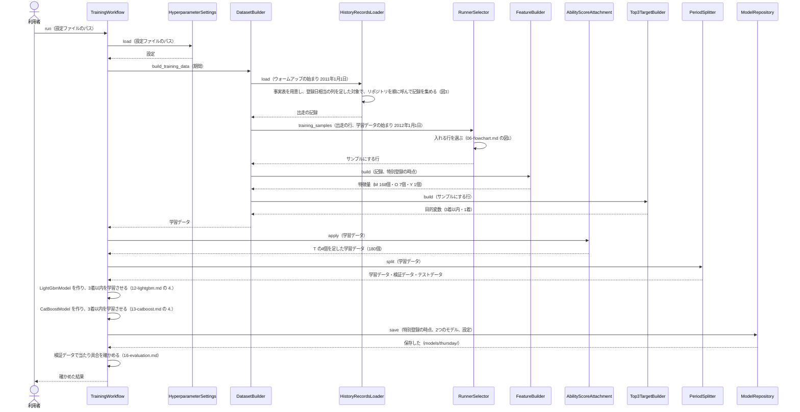
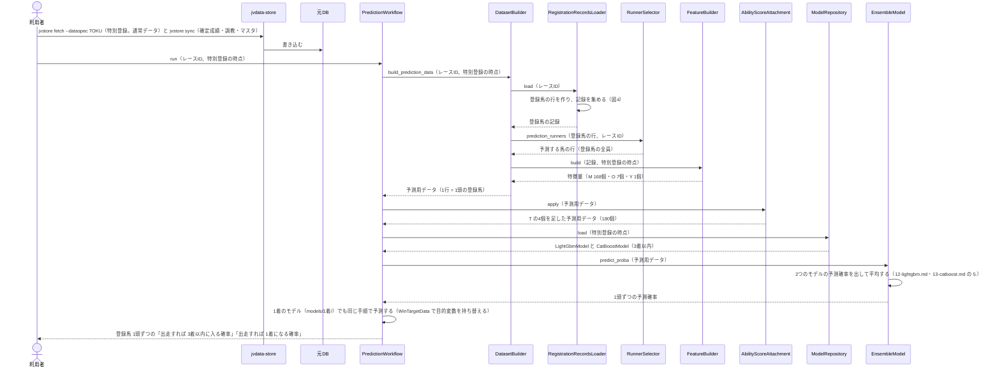
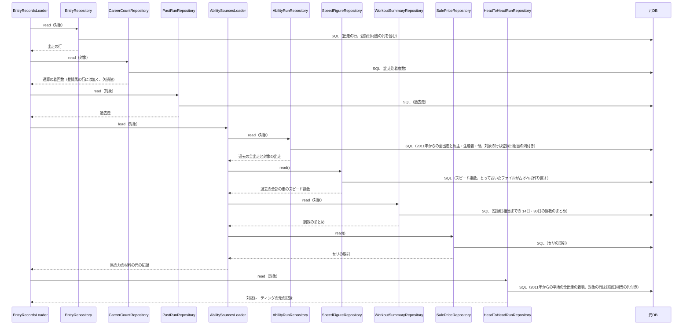
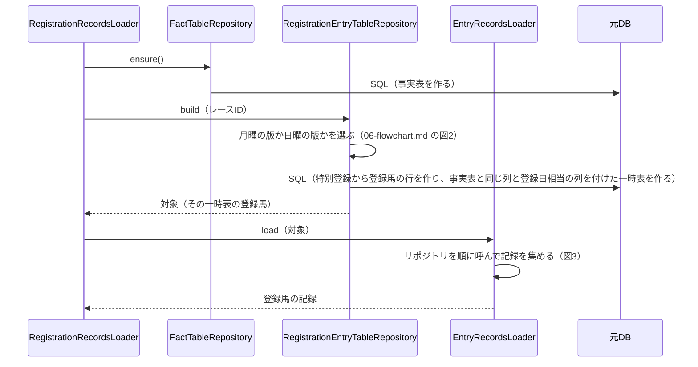
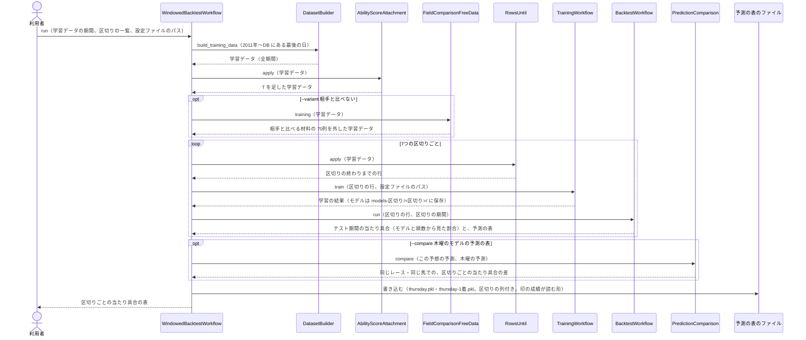
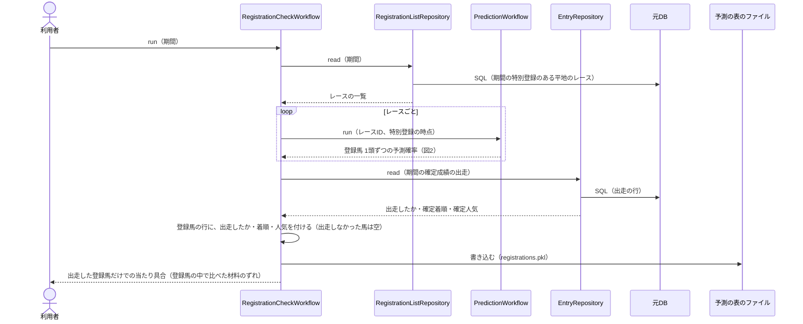
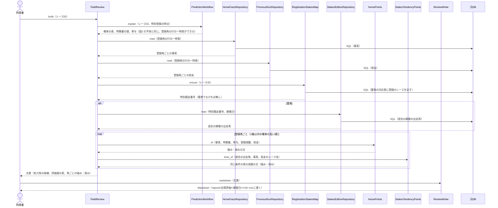

# 05 学習と予測のやりとり（シーケンス図）

**この文書で示すこと:** 学習・予測・7つの区切りでの確かめ・登録馬の確かめのとき、利用者・jvdata-store・元DB と、[04-classes.md](04-classes.md) のクラスが、どの順に、どのメソッドを呼ぶか。

**結論: 流れは「学習」「予測」「7つの区切りでの確かめ」「登録馬の確かめ」の4つに分かれる。** 学習は共通の `TrainingWorkflow` が進め、1つの学習データから、特別登録の時点の 3着以内のモデルと1着のモデル（LightGBM と CatBoost）を学習して保存する。予測は共通の `PredictionWorkflow` が進め、特別登録から登録馬の行を作って予測用データにし、保存した2つのモデルで予測確率を出して平均する。7つの区切りでの確かめは `WindowedBacktestWorkflow`、登録馬の確かめは `RegistrationCheckWorkflow` が進める。中央の予想の木曜のモデルと違うのは、予測の元が出走馬名表（`ra`・`se`）ではなく特別登録（`tk`）であること、材料を登録日相当で切ること、オッズ・速報・展開の予想（P）の段が無いことである。

- public メソッドの中の判断（if 文による分かれ道）は [06-flowchart.md](06-flowchart.md) を参照。2種類の図の使い分けは [01-overview.md](01-overview.md#図の使い分け) を参照。
- 用語の意味は [02-glossary.md](02-glossary.md) を参照。

## 図に出てくるもの

| 名前 | 種類 | 呼ばれ方 | 今あるか |
|---|---|---|---|
| 利用者 | 人 | ― | ― |
| jvdata-store | 隣のリポジトリの道具。JV-Data を取得して、元DB に入れる | コマンド（`jvstore sync` か `jvstore fetch --dataspec TOKU`）を1回実行する | ある |
| 元DB | jvdata-store が作った DuckDB（`jvdata.duckdb`）。この AI は読むだけ | SQL を1回流す | ある |
| `TrainingWorkflow` など | この AI のクラス。一覧と仕事は [04-classes.md](04-classes.md) を参照 | public メソッドを1回呼ぶ | 共通の部品はある（`src/yosou/shared/`）。この予想の部品（`src/yosou/special_registration_top3/`）と、共通の部品に足すことは、これから作る |
| `LGBMClassifier`・`CatBoostClassifier` | ライブラリのクラス | `fit()` か `predict_proba()` を1回呼ぶ | ライブラリはある |
| モデルのファイル | 学習済みのモデルを保存したファイル | 1回書き込むか、1回読み込む | `train` を実行すると、`reports/特別登録馬の近走と適性から3着以内を予想/models/` にできる |
| 予測の表のファイル | `backtest`・`registrations` が書く、道具「印の成績」が読む形の表 | 1回書き込む | `reports/特別登録馬の近走と適性から3着以内を予想/predictions/` にできる |

## 図の読み方

中央の予想の [05 の「図の読み方」](../近走と適性から3着以内を予想/05-sequence.md#図の読み方) と同じ。実線の矢印1本 = 呼び出し1回、点線 = 戻り値、自分に戻る矢印 = メソッドの中で行う作業のうち設計として見せたいもの、`loop` = くり返し、`opt` = 利用者の手順の違い。

## 図1. 学習

**説明。** この図は、1つの目的変数の学習である。`train`（`TrainCommand`）は、`registration_dataset_builder` で学習データを1回読み、元DB を閉じてから、同じ学習データで次の2つの学習を順に行う。T を足すのは `TrainCommand` が `TrainingWorkflow.train()` を呼ぶ前で、学習データの能力指数と負担重量から作る（外の表もモデルも要らない）。

| 学習 | 学習データ | 置き場所 |
|---|---|---|
| 3着以内のモデル | 180個の特徴量と目的変数「3着以内」 | `models/thursday/` |
| 1着のモデル | 目的変数を「1着」に持ち替えたもの（`WinTargetData`。オッズが無いので基準は無し。特徴量は同じ 180個） | `models/1着/thursday/` |

モデルは、1つの時点 × 2つの目的変数で 2組（LightGBM と CatBoost で 4個）になる。中央の予想と違い、券種オッズなしのモデルと複勝の見込みの倍率は無い（オッズを使わない）。

## 図2. 予測

特別登録が出たあと（月曜の夕方以降）に、1レースの登録馬を予測するときの流れ。

**説明。** 利用者は、まず jvdata-store で特別登録（`TOKU`。セットアップでは今週・来週分しか取れないので、通常データ `--option 1` で取る。取り方は jvdata-store の README）と、確定成績・調教・マスタ（`jvstore sync`）を取り込む。次に、レースID（か `--date --venue --race`）を付けて `PredictionWorkflow.run()` を呼ぶ。流れは中央の予想の [05 の図2](../近走と適性から3着以内を予想/05-sequence.md#図2-予測) から、オッズを決める段（`OddsResolver`）・券種オッズなしへの切り替え・展開の予想（P）・期待値の段を除いたものである。T を足すのは `PredictCommand` が `PredictionWorkflow` に渡す「予測用データに列を足す関数」（`extras`。中央の予想が木曜に T を足すのと同じ形）で行う。

## 図3. 記録を集める（リポジトリとのやりとり）

図1の「リポジトリを順に呼んで記録を集める」と、図4の `EntryRecordsLoader.load()` の中の呼び出しのうち、この予想が使うものを示す。中央の予想の [05 の図3](../近走と適性から3着以内を予想/05-sequence.md#図3-記録を集めるリポジトリとのやりとり) と比べて、`MarketRunRepository`（L）と `PoolProbabilityLoader`（N）を渡さず、`HeadToHeadRunRepository`（O）を渡す。共通の読み込みが呼ぶ調教・騎手・調教師・血統の日ごとの成績のリポジトリ（今の材料 C〜I の元）は、この予想の特徴量が使わないので図では省く（呼ばれるが、作る特徴量が無い）。

**説明。** 学習でも予測でも、同じリポジトリを同じ順に呼ぶ。違うのは「対象」（`TargetScope`）だけで、学習では「ウォームアップの始まり（2011年1月1日）以降の全部の出走に、登録日相当の列を足したもの」、予測では「1レースの登録馬の行の一時表」になる。材料の締めの日（登録日相当）は、`WorkoutSummaryRepository` が SQL の中で、`CumulativeRecordRates`・`RecentRecordRates`・`RatingHistoryBuilder` が読んだ行の `as_of_date` の列で守る（[11-leak-prevention.md の 6](11-leak-prevention.md#決まり)）。M は通算の成績を 2011年から数えるので、対象が1レースでも、その前の全出走を読む（予測では `AbilityRunFocus` が要る出走だけに絞る。中央と同じ）。

## 図4. 登録馬の記録を集める

図2の「登録馬の行を作り、記録を集める」の中の呼び出しを示す。中央の予想の [05 の図4](../近走と適性から3着以内を予想/05-sequence.md#図4-1レースの記録を集める速報の反映) と比べて、出走馬名表の一時表（`RaceEntryTableRepository`）の代わりに登録馬の行の一時表を作り、速報（馬場状態・馬体重・取消）とオッズの段が無い。

**説明。** 特別登録が元DB に無ければ、`RegistrationEntryTableRepository.build()` が `LookupError` を投げ、`PredictCommand` が取り込み方（`jvstore fetch --dataspec TOKU --option 1`）を案内して止まる。木曜以降に出走馬名表（`ra`・`se`）が元DB にあっても読まない（登録馬の行は `tk` からだけ作る。[11-leak-prevention.md の 7](11-leak-prevention.md#決まり)）。

## 図5. 7つの区切りでの確かめ

`backtest` の流れ。過去で学習して次の半年を予想する確かめを、7つの区切りで行う（[16-evaluation.md の 4.](16-evaluation.md#4-7つの区切りでの確かめ)）。

**説明。** 学習データは全期間で1回作り、区切りごとに終わりの日で切って（`RowsUntil`）、その区切りの `TrainingPeriod`（学習・検証・テストの始まり）で学習と確かめを行う。`BacktestWorkflow` は地方の予想の [05 の図4](../地方競馬の近走と適性から3着以内を予想/05-sequence.md#図4-テスト期間の確かめ) と同じもので、時点は特別登録の1つ、券種オッズなしの振り分けは無い（渡さない）。予測の表は、道具「印の成績」が読む列（レースID・開催日・馬ID・馬番・確率・区切り・期間・区分と、モデルごとの確率）で書く。馬番は確定成績から付ける（印の成績が買い目を組むのに使う。予測の材料には使っていない）。

## 図6. 登録馬の確かめ

`registrations` の流れ。テスト期間の特別登録の登録馬の全員に予測を出し、出走の有無と結果を突き合わせる（[16-evaluation.md の 7.](16-evaluation.md#7-登録馬全員に出した予想の確かめ)）。

**説明。** モデルは、確かめる期間を学習に使っていないもの（既定は 2026年の区切りのモデル。学習は 2025年6月まで）を使う。特別登録は 1年分しか無いので、確かめられるのはテスト期間（2026年1月〜）だけである。

## 図7. 全頭評価

道具「全頭評価」（`tools/全頭評価/review.py`）が、1レースの登録馬の全頭評価を書くときの流れ（[04-classes.md の tools/全頭評価](04-classes.md#tools全頭評価--全頭評価の道具)）。

**説明。** 予測は図2 と同じ（登録馬の行から。速報・オッズは読まない）。事実と前走は、予測のときにできた登録馬の行の一時表と事実表から読む。重賞の傾向は、同じ特別競走番号の過去の開催（2011年以降）の出走馬から、登録馬と同じ条件の馬の成績を数える。文書には印・期待度・買い目・想定人気を書かない。

## 今は無く、これから作るところ

| 図の中の部分 | 今の状態 |
|---|---|
| 登録馬の行の SQL（`tools/共通/registration.py`）と、事実表の SQL が `ra`・`se` の代わりに読む関係（`EntryRows`） | 無い。[04-classes.md の 3.](04-classes.md#3-共通の部品に足すこと) |
| 材料の締めの日（`as_of_date`）を守る共通の部品（`TargetScope`・調教のまとめ・通算と直近の成績・対戦レーティング） | 無い。今は開催日の前日まで |
| `RegistrationEntryTableRepository`・`RegistrationRaceRepository`・`RegistrationListRepository`・`RegistrationRecordsLoader`・`RegistrationCutoff`・`FieldComparisonFreeData`・`SpecialRaceFeatures`・`WindowedBacktestWorkflow`・`PredictionComparison`・`RegistrationCheckWorkflow`・コマンド | 無い |
| 合成DB の `tk`・`tk__登録馬毎情報` | 無い |
| 特別登録の元DB への取り込み（`jvstore fetch --dataspec TOKU --option 1`） | 道具はある。1年分（2025年10月〜）が入っている。これより前は JRA-VAN の提供期間（1年）の外で取れない（[09-features.md の「使うデータの期間」](09-features.md#使うデータの期間)） |
| 学習データ・検証データ・テストデータの期間の分け方と、評価指標 | 決めた（[16-evaluation.md](16-evaluation.md)。中央の予想と同じ区切りと指標） |
| 予測確率を利用者に見せる形 | 確率の高い順の表（[04-classes.md の「コマンドの引数」](04-classes.md#コマンドの引数)）。今週の予想・検索画面に並べるのは道具側の作業で、この設計書の範囲外（[16-evaluation.md の「今はしないこと」](16-evaluation.md#今はしないこと)） |

## 文書情報

| 項目 | 内容 |
|---|---|
| 作成日 | 2026-10-13 |
