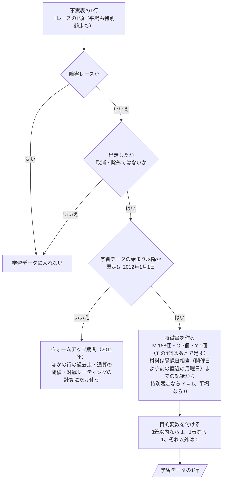
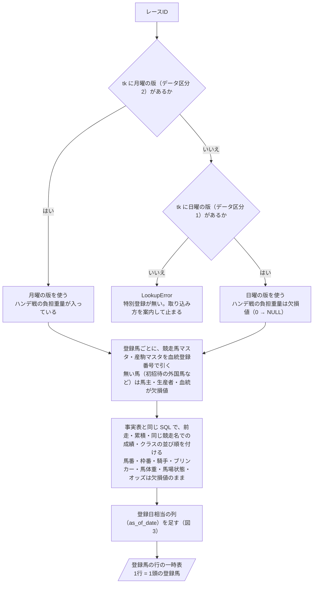
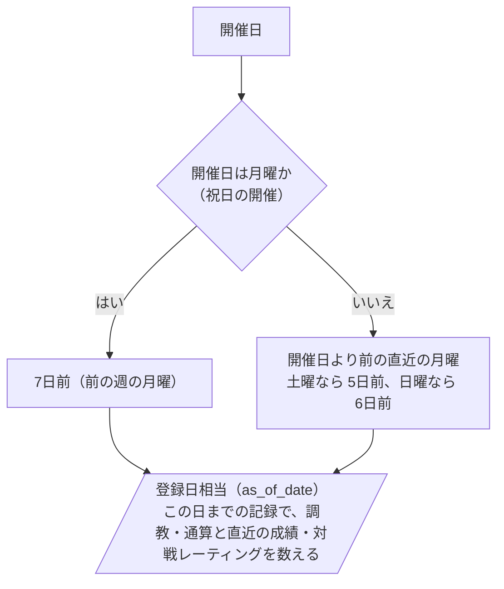

# 06 判断の手順（フローチャート）

**この文書で示すこと:** 学習データを作るとき・予測するときの、条件によって分かれる判断の手順。

**結論: 両方のモデルに共通で、条件によって分かれる判断は「学習データに入れる行の選び方」（図1）と「登録馬の行の作り方」（図2）と「登録日相当の決め方」（図3）の3つである。** 中央の予想にある「予測に使うオッズの決め方」と「当日のモデルの選び方」は、オッズを使わないこの予想には無い。

- この文書は、1つの public メソッドの中で、条件で分かれる判断の手順を示す。クラスどうしのやりとりは [05-sequence.md](05-sequence.md) を参照。2種類の図の使い分けは [01-overview.md](01-overview.md#図の使い分け) を参照。
- モデルごとの判断の手順（カテゴリ特徴量の値の変え方）は、この予想にはカテゴリ特徴量が無いので無い（[12-lightgbm.md](12-lightgbm.md)・[13-catboost.md](13-catboost.md)）。
- 用語の意味は [02-glossary.md](02-glossary.md) を参照。

## 図の読み方

中央の予想の [06 の「図の読み方」](../近走と適性から3着以内を予想/06-flowchart.md#図の読み方) と同じ。四角 = 作業、ひし形 = if 文1つ、平行四辺形 = できあがるもの、矢印 = 作業の順番。

## 図1. 学習データに入れる行の選び方

`RunnerSelector.training_samples()`（`DatasetBuilder.build_training_data()` から呼ばれる）の中で行う判断と、そのあとの段。事実表の1行（1レースの1頭）が、学習データの1行になるまで。中央の予想の [06 の図1](../近走と適性から3着以内を予想/06-flowchart.md#図1-学習データに入れる行の選び方) と同じ3つの問いで、違うのは学習データの始まりの既定と、特徴量の数、特別競走に絞らず印（Y）で区別することである。

**説明。** 特別競走に絞らず、平場も入れる。対象のレース（特別登録のあるレース）だけで学ぶより、全部のレースで学んで「特別競走か」を印（Y）で区別するほうが、行が4倍あって学びやすい（[08-training-data.md の「3. どのサンプルを入れるか」](08-training-data.md#3-どのサンプルを入れるか)）。出走しなかった登録馬は、事実表に出走の行が無い（取消・除外の行は「出走したか」で落ちる）ので、学習データに入らない（[10-target.md](10-target.md#出走しなかった登録馬の扱い)）。「登録日相当までの記録から」はリークを防ぐためで、[11-leak-prevention.md](11-leak-prevention.md) を参照。

3つ目の問いの日は、`train` の引数 `--train-from` で変えられる（[08-training-data.md の 4.](08-training-data.md#4-期間の指定)）。予測用データを作るときも同じ手順を通る。ただし、登録馬の行なので2つ目の問い（出走したか）は常に「はい」（出走するとみなす）、3つ目の問いも常に「はい」になり、目的変数を付ける段は無い。

## 図2. 登録馬の行の作り方

`RegistrationEntryTableRepository.build()`（`RegistrationRecordsLoader.load()` から呼ばれる）の中で行う判断。特別登録（`tk`）から、事実表と同じ列を持つ登録馬の行の一時表ができるまで。

**説明。** 削除の版（データ区分 0）は読まない。同じ版が何度か送られていれば（`_版`）、いちばん新しいものを使う。木曜以降に出走馬名表（`ra`・`se`）が元DB にあっても、この手順は `tk` からだけ行を作る（[11-leak-prevention.md の 7](11-leak-prevention.md#決まり)）。日曜の版だけのときの扱いは [15-decisions.md の 12](15-decisions.md#12-外国馬地方馬と日曜の版だけのレースの扱い)。

## 図3. 登録日相当の決め方

`RegistrationCutoff.of()`（SQL の式 `RegistrationCutoff.sql()` も同じ判断）の中で行う判断。開催日から、材料の締めの日（登録日相当）を決める。学習データの過去のレースにも、予測する登録馬の行にも、同じ決め方で付ける（[11-leak-prevention.md の 6](11-leak-prevention.md#決まり)）。

**説明。** 特別登録の月曜の版は、発走の 5〜6 日前の月曜に作られるものが 4 分の 3 で、火曜・水曜に作られるものもある（[07-prediction-timing.md の「特別登録がいつ出るか」](07-prediction-timing.md#特別登録がいつ出るか)）。学習データの過去のレースには特別登録そのものが無い（提供期間が 1 年）ので、作成日ではなく開催日から決める。登録が火曜・水曜に出たレースでも、予測では月曜までの材料を使う（火曜・水曜の調教は使わない）。学習と予測で同じ締め方にするためである。日曜の版（ハンデ発表前）で予測するときも、締めの日は同じ月曜にする（日曜の時点では、その月曜の記録はまだ無いので、あるものまでで数える。[15-decisions.md の 8](15-decisions.md#8-登録日相当の決め方)）。

## 文書情報

| 項目 | 内容 |
|---|---|
| 作成日 | 2026-10-13 |
