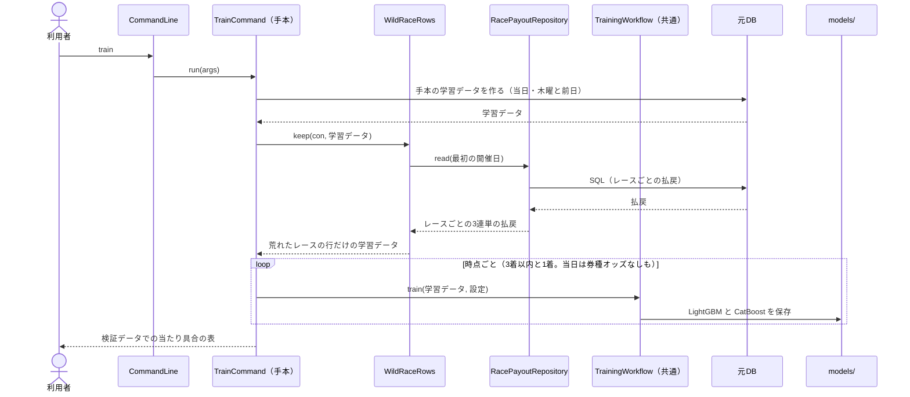
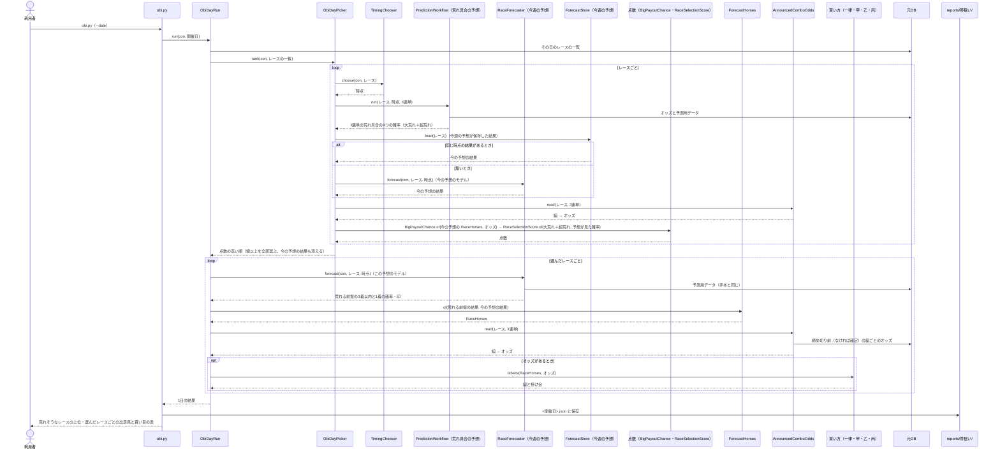

# 05 学習と予測のやりとり（シーケンス図）

**この文書で示すこと:** 学習と予測のとき、利用者・元DB と、[04-classes.md](04-classes.md) のクラスが、どの順に、どのメソッドを呼ぶか。

**結論: 流れは「学習」と「予測と買い目」の2つに分かれる。** 学習は `train` で、手本の `TrainCommand` が学習データを作り、`WildRaceRows` が荒れたレースの行だけを残してから、手本と同じ形で学んで保存する。予測と買い目は道具「帯狙い」の `ObiDayRun` が進め、レースごとに点数（荒れ具合の予想の確率と、今の予想の結果と3連単のオッズから出す予想が見た確率の平均）を出して線以上のレースを全部選び、選んだレースを `RaceForecaster` で荒れる前提の予想をして、買い方で1万円の買い目を組む。

図の読み方（凡例）は [手本の 05 の「図の読み方」](../近走と適性から3着以内を予想/05-sequence.md) を参照。用語の意味は [02-glossary.md](02-glossary.md) を参照。

## 図1. 学習

説明。学習データを作る段（元DB を開いている間）に、`WildRaceRows` が払戻を読んで行を絞る。そのあとは手本の学習とまったく同じで、置き場所だけが `reports/荒れる前提で着順を予想/models/` になる。

## 図2. 予測と買い目

説明。`RaceForecaster` には、この予想のモデルの置き場所を渡す。そのため、予測用データの作り方・材料の足し方・印の付け方・危険な人気馬の判定は、今週の予想とまったく同じで、確率だけが荒れる前提のモデルのものになる。その日の全レースを今の予想でも予想する（保存した同じ時点の結果があれば読む）のは、点数（予想が見た 1,000倍以上になる確率）と、一律の買い方の2着・3着の重みに使うためである（[15-decisions.md の 6・8](15-decisions.md#6-組の確率の2着3着の重み)）。今の予想は1レース数十秒かかるので、先に今週の予想を動かしておくと速い。組ごとのオッズが無いとき（当日の速報の前）は、買い目を組まず、当日にもう一度動かすことを結果に書く。

## 文書情報

| 項目 | 内容 |
|---|---|
| 作成日 | 2026-10-12 |
