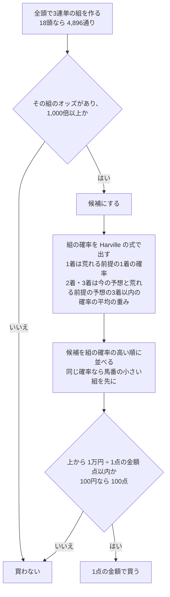
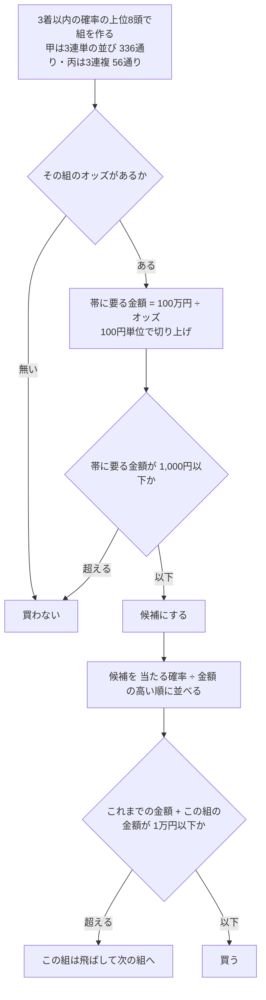
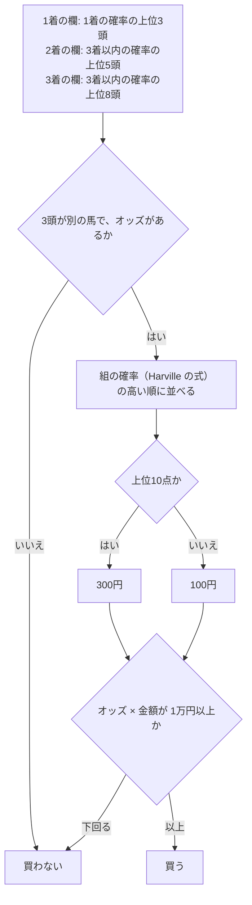

# 06 判断の手順（フローチャート）

**この文書で示すこと:** 条件によって分かれる判断の手順。

**結論: この予想だけの判断は3つある。「一律で、どの組を買うか」（`FlatPlan.tickets()`）、「甲・丙で、どの組をいくらで買うか」（`ObiStakePlan.tickets()`）、「乙で、どの組をいくらで買うか」（`FormationPlan.tickets()`）である。** レース選び（`ObiDayPicker`）は、点数が線以上かどうかの1つの判断だけなので、図にしない（予想が見た確率が無いレースは、荒れ具合の確率だけを点数にする）。 学習データに入れる行の選び方（`WildRaceRows.keep()`）は、払戻が線以上かどうかの1つの判断だけなので、図にしない（[08-training-data.md](08-training-data.md#3-どのサンプルを入れるか)）。

図の読み方（凡例）は [手本の 06 の「図の読み方」](../近走と適性から3着以内を予想/06-flowchart.md) を参照。

## 図1. 一律の買い目（`FlatPlan.tickets()`）

## 図2. 甲・丙の買い目（`ObiStakePlan.tickets()`）

## 図3. 乙の買い目（`FormationPlan.tickets()`）

## 文書情報

| 項目 | 内容 |
|---|---|
| 作成日 | 2026-10-12 |
