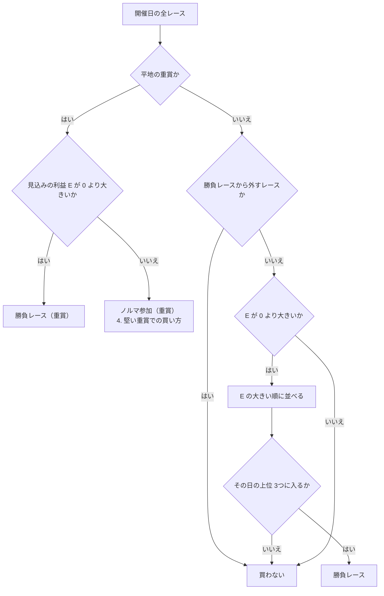

# 03 モジュール1: 買うレースの選び方

この文書で決めること: 週末の全レースから、どのレースを買うか。荒れるレースをどう数にするか。購入ポリシー（重賞は必ず買う・土日それぞれ最低1レース買う）をどう満たすか。堅い重賞でどう買うか。レースごとに添える目安（的中率・配当率）をどう出すか。

結論:

- **荒れるかどうかは、既存の荒れ具合の予想が出す「券種ごとの中荒れ以上の確率」で数にする。** ハンデ戦・多頭数・馬場状態などに手で点数を付けて足すことはしない。これらはすでに予想の特徴量に入っていて、組み合わせの効き方をモデルが学んでいる。
- **レースの順位は「荒れそうか」ではなく「見込みの利益」で付ける。** 荒れそうなレースほど期待値が高いとは限らないからである。荒れ具合は、木曜の候補の絞り込みと、券種の選び方に使う。
- **購入ポリシーは、開催日（土日と、祝日の月曜など）ごとに次の順で満たす。** ① 平地の重賞は全部入れる（障害の重賞は入れない）。② 重賞以外で見込みの利益があるレースを、大きい順に1日3つまで入れる。③ それでも1レースも無い日は、前日に決めた予備の1レースを買う。
- **堅い重賞は「ノルマ参加」として、損の小さい複勝だけを最大2点、ポリシー用の財布から小さい予算で買う。**
- **レースごとに、◎ランク（◎ の1着の確率 ＋ 単勝の期待値 − 1 の点数の S・A・B・C。高いほど ◎ の単勝・複勝の的中率と回収率が高い）・的中率（◎ の単勝が当たる確率）・配当率（配当が中荒れ以上になる確率の S・A・B・C）を添える。** 買うレースの選び方と買い目は、この目安では変えない（この文書の 5）。

## 1. 荒れるレースの定義

**荒れるとは、払戻が券種ごとの線を超えることである。** 線は既存の荒れ具合の予想で決めてあり、固い・中荒れ・大荒れ・超荒れの4段階に分ける（線の値は [荒れ具合の予想 の 10「券種ごとの線引き」](../レースの荒れ具合を4段階で予想/10-target.md) にだけ書いてある）。券種は単勝・馬連・3連複・3連単の4つで見る。1つの券種だけでは、「1着は人気馬だが2・3着が荒れた」レースを見落とすからである。

荒れ具合の予想（`src/yosou/upset_level/`）は、レースごとに4券種 × 4段階の確率を出す。この提案では、次の値を「波乱度」と呼んで使う。

```text
波乱度 U = （単勝・馬連・3連複・3連単の、中荒れ以上の確率）の平均     … 0〜1
```

例（架空）: 単勝 0.40・馬連 0.55・3連複 0.60・3連単 0.65 なら、U = 0.55。

### 要件の例（ハンデ戦・多頭数・馬場状態）の扱い

要件に挙がった条件は、どれも荒れ具合の予想の特徴量にすでに入っている。

| 要件の例 | 予想の中での扱い |
|---|---|
| ハンデ戦 | レース条件の特徴量（重量種別） |
| 多頭数 | レース条件の特徴量（頭数） |
| 馬場状態 | レース条件の特徴量（馬場状態。当日は速報 `0B14` の値） |
| 1番人気が抜けているか | オッズの形の特徴量（1番人気のオッズ、上位人気のオッズの開き。前日と当日だけ） |
| 同じ条件の過去の荒れ方 | 過去の同条件の荒れ率の特徴量 |

**手で点数を付けて足さない理由:** 効き方が組み合わせで変わるからである。例えば、多頭数のハンデ戦でも、1頭だけ抜けて強い馬がいれば固く収まる。手で「ハンデ戦 +10点・16頭以上 +10点」と足すと、この組み合わせを見分けられず、同じことを二重に数えてしまう。

### 今後の改善

研究「既存モデルの改善」では、**3つの予想（全頭・穴馬・人気馬）を組み合わせた馬ごとの勝率から荒れ具合を計算する方法が、4券種 × 7区切りのすべてで今の予想より良かった**（[research/既存モデルの改善 の 2](../../../research/既存モデルの改善/docs/02-結果の読み方.md)）。ただし全券種の締め切り前のオッズが要るので、本番には使っていない。jvdata-store が `0B30`（全券種の速報オッズ）を取るようになったので、数週ためたら当日の時点をこの方法に切り替える。

## 2. レースの点数

**レースの順位は、時点によって次の点数で付ける。**

| 時点 | 点数 | 理由 |
|---|---|---|
| 木曜 | 波乱度 U | オッズがまだ無く、期待値が出せない。荒れそうなレースを候補として残すだけに使う |
| 前日・当日 | 見込みの利益 E | 期待値が出せる。お金に直結する点数で並べる |

```text
見込みの利益 E = Σ（期待値 − 1）× 掛け金      … 期待値が線以上の買い目だけを足す
最大の期待値 M = そのレースの買い目の期待値の最大                … 線に届かないレースも含めて比べるときに使う
```

- 期待値と線の決め方は [07-expected-value.md の 2](07-expected-value.md#2-期待値の式)、掛け金は [08-bankroll-and-review.md の 2](08-bankroll-and-review.md#2-勝負レースの中の掛け金) を参照。
- 例（架空）: 期待値 1.35 の複勝に 1,000円、期待値 1.22 の複勝に 1,000円なら、E = 350 + 220 = 570円。

**波乱度で並べない理由:** 荒れそうなレースは、ほかの人も穴馬を買うので、穴馬のオッズが下がり期待値が上がらないことがある。研究「既存モデルの改善」でも、「荒れそう」を条件にするだけでは回収率は 100% に届かなかった。

### 木曜の候補の絞り込み

木曜は、次のどれかに当たるレースを候補に残し、前日に期待値を出す。候補を絞るのは、前日のオッズを見る手間を減らすためである（全レースの期待値を出せるなら、絞らなくてよい）。

- 重賞
- 波乱度 U が、その週のレースの上位 3割
- 平場・特別で、ほかの時点の予想（展開・能力）で人気になりそうな馬に不安がある（[07 の 3](07-expected-value.md#3-危険な人気馬の判定) の木曜版）

### 勝負レースから外すレース

次のレースは、期待値が出ても勝負レースにしない（ノルマ参加の予備にはしてよい）。

| 外すレース | 理由 |
|---|---|
| 新馬戦 | 過去の走が無く、能力スコア・展開スコアが出せない。補正が効かず、市場の確率そのままになる |
| 障害レース | 能力指数を出していない。予想のどれも障害を学習していない |
| 出走が7頭以下 | 複勝が2着までになり、複勝の期待値の見積もり（3着以内が前提）が合わない |

ルール集の ALL-09（ハンデ戦・不良馬場・夏競馬などを見送る）は、**使わない。** 未検証で、荒れ具合の予想とも食い違う（[ルール集 01「ルール同士の食い違い」](../../rules/馬券の買い方/01-overview.md)）。見送るかどうかは、期待値に任せる。

## 3. 購入ポリシーを満たすレースの選び方

**開催日ごとに、次の順で買うレースを決める。** 1日は、土曜・日曜に加えて、祝日の月曜などの開催日も含む。どの開催日も、最低1レースを買う（利用者の決定、2026-09-27）。必ず買う重賞は、平地の G1・G2・G3 だけで、障害の重賞は入れない（同じく利用者の決定。障害は能力指数も予想も無く、期待値が出せないため）。障害の重賞は、ほかの障害レースと同じく買わない。



そのあと、**その日の勝負レースと重賞が0レースなら、ノルマ参加（日）を1レース選ぶ。** 選び方は次のとおり。

1. **前日の夜に、予備を1つ決めておく。** 重賞以外（新馬戦・障害は除く）で、前日のオッズで最大の期待値 M が最も高いレース。
2. **当日、予備のレースの締め切り10分前に、その日まだ1レースも買っていなければ、予備を買う。** 買い方は堅い重賞と同じ（この文書の 4）で、予算はノルマ参加（日）の額（[08 の 1](08-bankroll-and-review.md#1-予算の分け方)）。
3. 当日のオッズで別のレースが勝負レースになり、先に買えていれば、予備は買わない。

**1日の上限を3つにする理由:** ルール集の ALL-06（勝負するレースを1日1〜3に絞る）と同じ考えで、買うレースが増えるほど、期待値の見積もりの誤差で線を越えただけのレースが混ざるからである。研究「既存モデルの改善」でも、上位 N レースの N を検証で選ばせると、ほとんど「全部」が選ばれて絞れなかった。**3 は初めの値で、締め切り前のオッズの記録が貯まったら検証で決め直す。**

### 作ったもの

道具「今週の予想」（`tools/今週の予想/forecast.py`）が、予想のあとに開催日ごとにこの選び方で計画を決める（`tools/今週の予想/day_planner.py`）。
計画は参加の種類（勝負／ノルマ参加（重賞）／ノルマ参加（日）／買わない）と理由・見込みの利益 E・最大の期待値 M・複勝の買い目と金額（[08 の 1](08-bankroll-and-review.md#1-予算の分け方)）で、
`reports/今週の予想/<開催日>/plan.json` と各レースの結果の JSON（`plan`）に書き、回顧の表1「買い目の記録」に買い目を書く。検索画面の「今週の予想」タブのレースの一覧と1レースの頭に出る。
計画のあとに、開催日ごとのまとめ（1行1レースの一覧・買うレースの表・競馬場ごとにレースの文（印・実際に買う買い目と参考の買い目・◎ の理由と近走））を
`reports/今週の予想/<開催日>/まとめ.md` に書く（`tools/今週の予想/day_summary.py`。保存してある予想と計画だけから作り、DB は開かない。出し直すのは `summary.py --date <開催日>`）。
予想はせずに計画だけ決め直すのは `forecast.py --date <開催日> --plan-only`。

- E は、その日のその時点の予想の複勝（◎の期待値 1.00 以上・16頭以上のレースで、期待値 1.1 以上・複勝 5倍以下の馬を高い順に最大3点。08 の 2）の Σ（期待値 − 1）を単位で数える（掛け金は1点1単位なので、単位で並べても同じ順になる）。
- オッズの無い木曜の予想は計画に入れない（E が出せない）。前日の計画は当日に予想し直すと作り直す（表1の未精算の行も書き直す）。
- 波乱度 U は木曜の候補の絞り込みには使っていない（全レースの期待値を前日・当日に出せるので、候補を絞る必要が無い。上の「木曜の候補の絞り込み」のただし書きのとおり）。同じ値を、レースごとの目安の配当率として出す（この文書の 5）。
- ノルマ参加（日）の予備は、勝負も重賞も無い日に M がいちばん高いレースを計画に入れる（「締め切り10分前にまだ買っていなければ」の判断は人がする。直前にデータを取って判断する仕組みは作らない）。

### 1日の例（架空）

土曜、中山と阪神で 24レース、重賞は1つ（G3）。

| レース | 重賞か | E | 決まったこと |
|---|---|---|---|
| 阪神11R | G3 | 0円 | ノルマ参加（重賞） |
| 中山7R | | 520円 | 勝負レース（1位） |
| 阪神9R | | 310円 | 勝負レース（2位） |
| 中山3R | | 150円 | 勝負レース（3位） |
| 阪神5R | | 90円 | 買わない（4位） |
| そのほか19レース | | 0円 | 買わない |

重賞があるので、この日はノルマ参加（日）の予備は使わない。

## 4. 堅い重賞での買い方

**堅い重賞とは、重賞で見込みの利益 E が 0（期待値が線を超える買い目が無い）のレースである。** 荒れ具合ではなく期待値で決める。荒れそうでも期待値の無い重賞はあり、固そうでも期待値のある重賞は勝負レースになるからである。

堅い重賞は「ノルマ参加（重賞）」として、次のように買う。

1. **券種を複勝に絞る。** 控除率がいちばん低く（20%）、3着以内に来れば当たるので、損の揺れが小さい。過去のデータでの検証で、期待値で選んだ買い目の回収率が、複勝はワイドよりはっきり高かった（[08 の 2](08-bankroll-and-review.md#複勝以外の券種の検証過去のデータで先に確かめる)。2026-09-27 にワイドから変えた）。
2. **複勝を期待値の高い順に並べ、上から最大2点を買う。** 期待値が線に届かなくても、少なくとも1点は買う（ポリシーを守るため）。
3. **1強のとき**（1番人気の市場の勝率が 0.5 以上。単勝でおよそ 1.6倍以下）も同じく、期待値の高い順に複勝を買う。1強の複勝は払戻が 1.1倍ほどにしかならず、期待値が上がりにくいので、ふつうは ☆（期待値の最も高い穴馬）の複勝が選ばれる。
4. **予算はノルマ参加（重賞）の額で、ポリシー用の財布から出す**（[08 の 1](08-bankroll-and-review.md#1-予算の分け方)）。

**穴馬の単勝にしない理由:** 研究「回収率100超」で、大穴の単勝は回収率が控除率の水準を大きく下回り、大穴の複勝なら 100% を超えた（[research/回収率100超 の 04 の 7](../../../research/回収率100超/docs/04-買い方.md)）。「大穴が勝つのを当てる」より「大穴が3着に来るのを当てる」ほうが、買われすぎていない。

### 例（架空）

G2、16頭立て、1番人気は単勝 1.4倍（市場の勝率 0.56）。☆は 9番人気で複勝の期待値 1.08、次に高いのは 6番人気の 0.97（どちらも線の 1.25 に届かない）。

| 買い目 | 期待値 | 金額 |
|---|---|---|
| 複勝 ☆（9番人気） | 1.08 | 500円 |
| 複勝 6番人気 | 0.97 | 400円 |

ポリシー用の財布が 3万円のときの例（予算 900円）。

## 5. レースごとの目安（的中率と配当率）

**全レースを買う前提の利用者が、レースごとに「当たりやすいか」「配当が大きくなりそうか」を一目で見るための目安である。** ◎ の単勝の期待値が 1.00 以上かどうかを「期待度（高・低）」としてレースに添えて見せる形は、何を見た数字か分かりにくかったのでやめ、次の2つの確率と等級に替えた（利用者の決定。[09 の 16](09-decisions.md#16-レースに添える目安を的中率と配当率にする)）。買い方の決まり（複勝・馬単・組の期待値の対象）は変えていない。

| 目安 | 中身 | 出す時点 |
|---|---|---|
| ◎ランク | ◎ の1着の確率 ＋（◎ の単勝の期待値 − 1）の点数を S・A・B・C にしたもの（S 0.35 以上・A 0.15 以上・B 0 以上・C 0 未満）。「当たりやすさ」と「市場より得か」を足した点数で、ランクが高いほど ◎ の単勝・複勝をべた買いしたときの的中率と回収率が高い（利用者の決定「ランクが高いほど的中率と回収率が高くなるように。S・A・B・C は的中率そのものでなくてよい」） | 前日・当日（木曜は期待値が無い） |
| 的中率 | ◎ の単勝が当たる確率（全頭の予想の1着のモデルの1着になる確率。2つのモデルの平均。利用者の決定「◎ が単勝で的中するかどうかで測る」）。% の値だけで、等級は付けない | 木曜・前日・当日 |
| 配当率 | 配当が中荒れ以上になる確率。荒れ具合の予想（`src/yosou/upset_level/`）が出す単勝・馬連・3連複・3連単の「中荒れ以上の確率」の平均（この文書の 1 の波乱度 U と同じ値） | 木曜・前日・当日（荒れ具合の予想が出せないレースは「なし」） |

配当率は 0〜100% の値と、次の線の等級で出す（線は下の値を含む）。◎ランクの線は上の表のとおり。

| 等級 | 配当率 | ◎ランクの点数 |
|---|---|---|
| S | 75% 以上 | 0.35 以上 |
| A | 50% 以上 75% 未満 | 0.15 以上 0.35 未満 |
| B | 25% 以上 50% 未満 | 0 以上 0.15 未満 |
| C | 25% 未満 | 0 未満 |

- 中荒れの線（券種ごとの払戻の額）は [荒れ具合の予想 の 10](../レースの荒れ具合を4段階で予想/10-target.md) にだけ書いてある。
- ◎ランク・的中率・配当率は、買うレースや買い目を決める条件には使わない。買い方の決まりが「◎の期待値 1.00 以上のレース」と呼ぶ条件（◎ の単勝の期待値が 1.00 以上。[07 の 5](07-expected-value.md#5-印の付け方)）は目安とは別に残り、予想の結果（`win_value_band`。値は `1.00 以上`・`1.00 未満`）に入る。
- ◎ランクの点数と線は、研究「全レース全券種の買い方」で、2015〜2018年の当日の予想で決め、2019〜2026年で ◎ の単勝・複勝のべた買いの的中率と回収率がランクの順に上がることを確かめた（[research/全レース全券種の買い方 の docs/02](../../../research/全レース全券種の買い方/docs/02-結果.md)）。
  ◎ の1着の確率だけでランクを付けると的中率は上がるが回収率は上がらず（当たりやすい馬ほど単勝が安い）、期待値だけだと回収率は上がるが的中率は下がるので、両方を足した。道具「印の成績」の表13 で、ランクごとの ◎ の勝率・複勝率・回収率を、モデルを直すたびに見る。
- 的中率は、確率をそのまま当たる割合として読む（1着のモデルの確率は、帯ごとに実際の勝率と合っている。[全頭の予想 の 16 の 6](../近走と適性から3着以内を予想/16-evaluation.md)）。
- 配当率は、荒れ具合の予想の学習の記録（検証データで、中荒れ以上の確率のしきい値を上げるほど、実際に中荒れ以上だった割合が上がる表）で読み方を確かめてある。7つの区切りの予測が無いので、表13 には出さない。

### 作ったもの（的中率と配当率）

道具「今週の予想」（`tools/今週の予想/race_grader.py`・`payout_rate.py`・`race_grades.py`。等級の線は `src/yosou/shared/race_grade/`）が、レースごとに ◎ランク・的中率・配当率を出し、
結果の JSON（`rank_score`・`rank`・`hit_rate`・`payout_rate`・`payout_grade`）、標準出力の表の注、全頭の予想根拠の頭、検索画面の「今週の予想」タブ（レースの一覧と1レースの頭）、次のレースの予想（スキル）に出す。
荒れ具合の予想の学習済みモデル（`reports/レースの荒れ具合を4段階で予想/models/`）が要る（道具「取得と予想の状況」が、あるかどうかを見る）。

## 文書情報

| 項目 | 内容 |
|---|---|
| 作成日 | 2026-09-27 |
| 更新 | 2026-09-27: 券種の検証の結果で、堅い重賞の買い方を複勝だけにした |
| 更新 | 2026-10-25: 5. を足した（レースごとの目安: 的中率と配当率。期待度（高・低）の表示をやめた） |
| 例の値 | すべて架空 |
