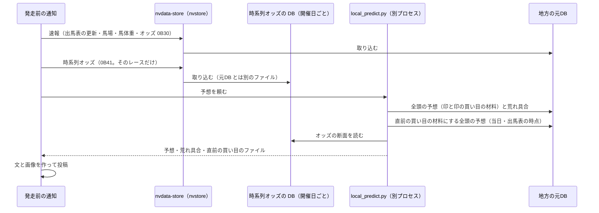

# 13 地方の直前の買い目（買い目を決める時刻に分かることだけで、単勝・馬単・3連単を買う）

**この文書で決めること:** 地方競馬の発走前の通知（`tools/発走前の通知/notify.py --local`）に出す「直前の買い目」を、どの材料で・どの馬に・どの券種で・いくらで出すか。
買い方をどう探したかは研究「地方の直前の材料で買う」（[README](../../../research/地方の直前の材料で買う/README.md)）に書いたので、ここでは本番の決まりだけを書く。

- 状態: **決定（作った。実際の通知での成績を確かめている途中）。** 道具「地方の直前の買い目」（`tools/地方の直前の買い目/`）と、発走前の通知の地方で使っている。
- 利用者の要望: 「（通知の時刻のオッズで）100% を超える買い方が見つかるまで試し続けて」「3連単は買いたい」「オッズにとらわれない買い目を選んで、回収率 100% 超えを目指してほしい」。
- 印の買い目（[12](12-local-mark-tickets.md)）と、通知に出さない推奨買目（[10](10-local-recommended-tickets.md)）は、確定オッズで確かめた買い方である。
  地方は買い目を決める時刻（締め切りの約10分前）のオッズと確定オッズが大きく違うので、この2つは実際の通知では確かめた成績にならない。
  直前の買い目は、買い目を決める時刻に分かることだけで学び、確かめた買い方である。
- 決めたこと: 券種は [09 の 35](09-decisions.md#35-地方の直前の買い目にほかの券種を足すか)。

## 1. 何を出すか

| 項目 | 決まり |
|---|---|
| 買う馬 | 2つのモデルの値が、どちらも線以上の馬（`LateRule`。買う馬らしさ 0.4 以上・戻りの見込み 0.95 以上）。1レースに2頭以上いれば全部 |
| 買う馬らしさ | 「確定オッズを材料にした全頭の予想が、単勝の期待値 1.0 以上で買う馬か」を当てるモデルの確率。確定オッズそのものは使わない（過去のレースで学ぶときの答えにだけ使う） |
| 戻りの見込み | その馬の単勝を 1 買ったときに戻る額を、じかに当てるモデルの値（1 が元） |
| 券種と組 | 単勝（その馬）、馬単（その馬 → 相手。相手は、その馬を除いた、全頭の予想の 3着以内の確率の高い順の 2頭。2点）、3連単（その馬 → 相手 → 相手。相手は、その馬を除いた、買い目を決めた時刻の単勝オッズの低い順の 5頭。20点） |
| 組の選び方 | 組のオッズは見ない（組の「確率 × そのときのオッズ」で選ばない）。地方は買い目を決める時刻のオッズと確定オッズが大きく違い、そのときのオッズで割安に見える組は、あとでオッズが下がるからである（[10](10-local-recommended-tickets.md#発走前の通知に出さない理由)） |
| 金額 | 1点 100円（単勝 100円、馬単 2点 200円、3連単 20点 2,000円）。相手が足りないレースは、いる頭数で組む |
| 買わないレース | 線を満たす馬がいないレース。大半のレースは買わない |
| 時点 | 当日の時点（馬体重が届いたあと）だけ。前日の時点では出さない |
| 頭数 | オッズと予想のそろった馬が 5頭以上 |
| 印の買い目との関係 | 別の買い方として、印の買い目のあとに出す |
| 期待度との関係 | 地方の期待度（[11](11-local-expectation.md)）は、この買い方の「線への近さ」（馬ごとに 買う馬らしさ ÷ 線 と 戻りの見込み ÷ 線 の小さいほうを取り、レースでいちばん大きい値。`LateRule.closeness`）を S・A・B・C にしたもの。買う馬がいるレースは 1 以上で、期待度 S になる |

## 2. 材料（全部、買い目を決める時刻より前に分かること）

| 材料 | どこから |
|---|---|
| 単勝オッズ（今・約10分前・約20分前・その日の最初の断面）と複勝オッズ（今） | そのレースの時系列オッズ（地方競馬DATA の 0B41）。発売中の断面だけを使う（`OddsSnapshotRepository`） |
| 今のオッズを材料にした全頭の予想（1着・3着以内の確率） | 地方の予想モデルの当日の時点（`LateProbabilities`） |
| オッズを使わない全頭の予想（1着・3着以内の確率） | 地方の予想モデルの出馬表の時点 |
| 競馬場・レース番号・頭数・曜日 | レースID と開催日 |

特徴量は、これらから作る 24 個（市場の見立て・人気順・オッズの動き・予想と市場の差 など。`LateFeatures`・`late_columns.FEATURES`）。
学ぶときも当てるときも同じ `LateFeatures` を通す。

全頭の予想のモデルは、学習用の表を作ったときと同じもの（`reports/地方競馬の近走と適性から3着以内を予想/models-2024検証`）を使う。
通知の印と印の買い目が使う本番のモデルとは別である（2つのモデルは、このモデルの確率の出方を学んでいるので、替えると学び直しが要る）。

## 3. 通知の流れの中での位置

- 時系列オッズは、元DB とは別の DuckDB（`reports/発走前の通知/地方/<開催日>/時系列オッズ.duckdb`）に取り込む。元DB に発売中の全部の断面を入れると、ほかの道具が読む表が大きくなるためである。
- 直前の買い目は、印の予想と同じプロセス・同じ接続で出す（地方の全成績の事実表を作るのが1回で済む）。
- 結果は `reports/発走前の通知/地方/<開催日>/<rid>.直前.json` に書く（買う馬・決めたときの単勝オッズ・2つのモデルの値・相手・材料にした断面の発表時刻・線への近さ。買う馬が無ければ理由）。

## 4. 通知での見せ方

- 文: 印の買い目のあとに「直前の買い目（確かめ中・1点 100円）:」の見出しと、買う馬ごとに3行
  （例 `- 単勝 3☆（決めたときの単勝 14.2倍）100円`、`- 馬単 3☆ → 7○,4◎（2点 200円）`、`- 3連単 3☆ → 4◎,7○,8▲,2,1 → 4◎,7○,8▲,2,1（20点 2,000円）`。値は架空）。馬番のあとに、その馬の印（◎○▲△☆注。[07 の 5](07-expected-value.md#5-印の付け方)）を添える。無印の馬は馬番だけ。印は買う馬の選び方には使わない（どの印の馬も、無印の馬も選ばれる）。
- 買う馬がいないときは「直前の買い目（確かめ中・1点 100円）: なし（2つの見込みがそろって線以上の馬がいない）」。
- 出せないとき（時系列オッズが取れない、馬体重が届く前、モデルが無い など）も「なし（理由）」と出し、印と印の買い目の通知は止めない。
- 「確かめ中」は、実際の通知の時刻のオッズでの成績（下の 5）が十分な回数たまるまで付ける。

## 5. 確かめ方

| 何を | どの道具で | 見るところ |
|---|---|---|
| 過去のレースでの成績（時間の順を守り、3か月ごとに学び直す。払戻は確定の値） | `uv run python tools/地方の直前の買い目/check.py` | 単勝・馬単・3連単の期間ごとの回収率と、払戻の上位5本を除いた回収率。2つめの表は、全レースを期待度で分けた、線にいちばん近い馬の単勝の成績（`reports/地方の直前の買い目/check.md`） |
| 実際の通知の成績（通知が書いた買い目を、確定の払戻で数える。人が記録するものは無い） | `uv run python tools/地方の直前の買い目/results.py` | 同じ形の表（`reports/地方の直前の買い目/results.md`） |

採った理由: 過去のレースで、単勝・3連単とも全体の回収率が 100% を超え、種を変えた作り直し・断面の時刻を変えた作り直し・最初の半年でも 100% を割らなかった。
馬単は、同じ馬を軸にして相手の選び方（人気順・1着の確率順・3着以内の確率順）と頭数（1〜5頭）を比べ、3着以内の確率順の 2頭が、確かめた年のどれでも 100% を超えた。
同じ軸の複勝・ワイド・馬連・3連複は、どの形でも年によって 100% を割るので買わない（研究の README）。

割り引いて見るところ:

- 線は全部の期間を見て選んだ。`check.py` の数字は、本当の値より高く出ている。
- 少ない高配当に頼る。払戻の上位5本を除くと回収率は大きく下がり、馬単と 3連単は四半期ごとの振れが大きい。
- 馬単の相手の選び方と頭数は、全部の期間を見て選んだ。
- 過去の確かめの「買い目を決める時刻」は、取り直した時系列オッズの断面で再現したものである。実際の通知で通用するかは `results.py` で確かめる。

## 6. 学び直し

本番用のモデルは `uv run python tools/地方の直前の買い目/fit.py` が `reports/地方の直前の買い目/models/` に書く（学習用の表の全部で学ぶ）。
学習用の表の作り方は、研究の [README の「学び直すとき」](../../../research/地方の直前の材料で買う/README.md#学び直すとき)。

## 7. クラス

| クラス | 仕事 | 場所 |
|---|---|---|
| `LateFeatures` | 材料の表から特徴量を作る | `tools/地方の直前の買い目/late_features.py` |
| `LateTargets` | 学習用の表に答えの列（先生が買う馬か・単勝の戻り）を足す | `late_targets.py` |
| `LateModels` | 2つのモデル（種を変えた数本の平均）を学ぶ・値を付ける | `late_models.py` |
| `LateModelStore` | モデルの保存と読み出し | `late_model_store.py` |
| `LateRule`・`LatePick` | 買う馬を選ぶ決まりと、買う馬（軸と相手・馬単と 3連単の組） | `late_rule.py`・`late_pick.py` |
| `LatePredictor` | 1レースの断面と予想の確率から買い目を決める | `late_predictor.py` |
| `LateProbabilities` | 材料にする全頭の予想の確率を出す | `late_probabilities.py` |
| `LateBets`・`LateBetFile` | 1レースの買い目と、そのファイルの読み書き | `late_bets.py`・`late_bet_file.py` |
| `LateTrainingTable`・`LateWalkForward` | 学習用の表を読む・時間の順を守って値を付ける | `late_training_table.py`・`late_walk_forward.py` |
| `LateSettlement`・`LateSummary`・`SavedLateBets` | 払戻を当てる・期間ごとにまとめる・通知が書いたファイルを集める | `late_settlement.py`・`late_summary.py`・`saved_late_bets.py` |
| `LateGradeTable` | 全レースを期待度（線への近さ）で分けて、線にいちばん近い馬の単勝の成績を表にする | `late_grade_table.py` |
| `OddsSnapshotRepository`・`WinPayoutRepository`・`ExactaPayoutRepository`・`TrifectaPayoutRepository` | 時系列オッズの断面・単勝の払戻・馬単の払戻・3連単の払戻を読む | `repository/` |
| `LateBetWriter` | 発走前の予想と同じ接続で買い目を出してファイルに書く | `tools/発走前の通知/late_bet_writer.py` |
