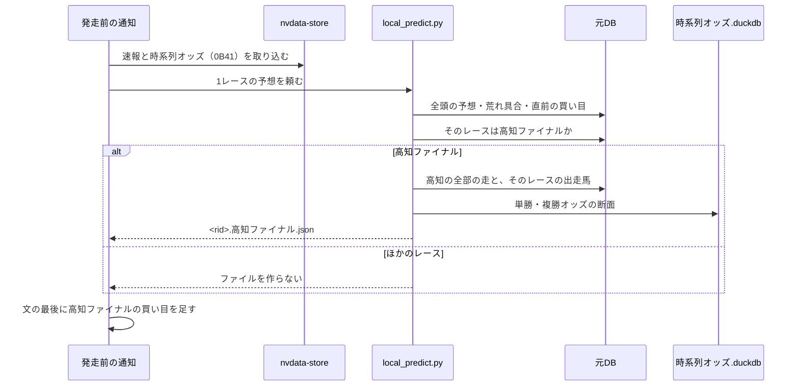

# 14 高知ファイナルの買い目（荒れる前提の専用の予想で、印と全券種の買い目を出す）

[← 概要に戻る](01-overview.md)

- 状態: **決定（作った。実際の通知での成績を確かめている途中）。** 道具「高知ファイナルの買い目」（`tools/高知ファイナルの買い目/`）と、発走前の通知の地方（`tools/発走前の通知/kochi_final_writer.py`）。
- 利用者の要望: 「高知ファイナルは荒れやすいので、高配当を前提にした予想を作って」「3連単は必ず買う」「1番人気を頭にしない」「全券種で 100% 超えを目指す」「買うのは発走の 10分前か 8分前」。
- 対象は、高知のその日の最終レースで、レース名に「ファイナルレース」が入るレースだけ。ほかのレースには何も出さない。
- 研究は [research/高知ファイナルの高配当/](../../../research/高知ファイナルの高配当/README.md)。事例と理論はそちらに書く。

## 1. 何を出すか

1レースにつき、印（◎ ○ ▲ △）と券種ごとの買い目を出す。1点 100円。

| 券種 | 買い目 | 買うレース |
|---|---|---|
| 単勝 | ◎ | 毎回 |
| 馬連 | ◎ − ○▲ | 毎回 |
| 馬単 | ◎ → ○▲ | 毎回 |
| 3連単 | ◎ → ○▲ → 相手5頭、◎ → 1番人気 → 相手、◎ → 相手 → 1番人気（重なる組は1回だけ） | 毎回 |
| 複勝 | ◎ | ◎ の複勝の見込みが線以上のレースだけ |
| ワイド | ◎ − ○▲ | 同上 |
| 3連複 | ◎ − ○▲ − 相手5頭 | 同上 |

- **◎** は、そのときの単勝人気が 2〜9 番人気の馬の中で、割安さがいちばん高い馬。割安さ = 予想の1着の確率 ÷ 単勝オッズが示す1着の確率。
- **1番人気は ◎ にしない。** 相手には入ることがある。
- **相手** は、◎ 以外を予想の3着以内の確率の高い順に5頭。先頭の2頭が ○▲、残りの3頭が △。
- **◎ の複勝の見込み** = 予想の3着以内の確率 × 複勝オッズの低いほう。線は `FinalRule` の `PLACE_LINE`。
- 印の買い目（[12](12-local-mark-tickets.md)）・直前の買い目（[13](13-local-late-tickets.md)）とは別の買い方で、どの合計にも入れない。

## 2. 予想（何を当てるか・材料）

当てるのは、馬ごとの「1着になるか」と「3着以内に入るか」。LightGBM を種を変えて5本と CatBoost を学び、平均する。

学ぶのは高知の 1300〜1600m・9頭以上の全部の走。ファイナルレースだけで学ぶより、当たり具合が良かった。

| 材料 | 中身 | クラス |
|---|---|---|
| 馬の近走 | 直近3走・5走の4コーナーと最初のコーナーの位置、着差、着順、人気、上がりの順位。ファイナルレースの出走数と成績。同じ距離の成績 | `HorseForm` |
| 騎手 | 直近365日の高知の騎乗数・勝率・3着以内率・位置の平均、人気から見込まれる数との比 | `JockeyForm` |
| 調教師 | 直近365日・30日の成績、その日のそのレースより前の成績 | `TrainerForm` |
| 馬と騎手の組 | その騎手で走った数と3着以内率、馬の全部の走との差 | `PairForm` |
| 速さの指数 | その日・その距離の全馬の時計の真ん中との差（走破タイムと上がり3ハロン）の近走 | `SpeedForm` |
| その日の傾向 | その日の、そのレースより前のレースで3着以内に来た馬の位置・枠・人気、騎手のその日の成績 | `DayTrend` |
| レースの中の比べ | 上の材料の、レースの中での順位と偏差 | `RaceRelative` |
| 単勝オッズ | オッズが示す1着の確率、そのときの人気、1番人気との差、近走の人気との差 | `RaceRelative` |

- 単勝オッズは、学ぶときは確定オッズ、予想するときは発走前の時系列オッズの断面を使う。
- その日の傾向は、ファイナルレースがその日の最後なので、その日の前のレース全部を使える。
- オッズを材料に入れない予想は、成績が大きく下がったので採らなかった。

## 3. 通知の流れの中での位置



- 予想と同じプロセス・同じ接続で出す。地方の全成績の事実表を使い回すので、作るのは1回で済む。
- 馬体重が届く前（前日の時点）でも出す。馬体重は材料の1つで、無ければ欠損値のまま予想する。
- 出せないとき（時系列オッズが取れない、モデルが無い、学んだ条件に合わない など）は「なし（理由）」を書き、印とほかの買い目の通知は止めない。

## 4. 通知での見せ方

文の最後に、見出しと印・券種ごとの行を出す（値は架空）。

```
高知ファイナルの予想（荒れる前提・確かめ中）（1点 100円・合計 20点 2,000円）:
- ◎5 ○1 ▲2 △3,4,6（1番人気 1 は ◎ にしない）
- 単勝 5（1点 100円）
- 馬連 1−5 / 2−5（2点 200円）
- 馬単 5→1 / 5→2（2点 200円）
- 3連単 5→1→2 / …（14点 1,400円）
- 複勝・ワイド・3連複: 見送り（◎ の複勝の見込み 0.70。0.85 以上で買う）
```

「確かめ中」は、実際の通知の時刻のオッズでの成績が十分な回数たまるまで付ける。

## 5. 確かめ方と分かっている弱み

- 確かめは、年ごとに「その年より前で学び、その年のファイナルレースを予想する」形で行った。時系列オッズのある年は、発走の約10分前・約8分前の断面を材料にした。払戻は確定の値で数えた。
- 数値は Git 対象外の `reports/高知ファイナルの高配当/` にある。
- 分かっている弱み:
  - 1年のレース数が少なく、少ない高配当に頼る。年ごとの回収率の上下が大きい。
  - ◎ の人気の帯と複勝の線は、全部の期間を見て選んだ。確かめの数字は、本当の値より高く出ている。
  - 発走前の断面のオッズと確定オッズは違う。予想が割安と見た馬は、最後に買われてオッズが下がることがある。
  - 同じ買い方は、高知のほかのレースでは通用しなかった。ファイナルレースだけに使う。

## 6. 学び直し

`uv run python tools/高知ファイナルの買い目/fit.py` が、元DB の高知の全部の走で学んで `reports/高知ファイナルの買い目/models/` に書く。開催中は元DB をじかに読まず、`--db` に写しを渡す。

## 7. クラス

| クラス | 仕事 | ファイル |
|---|---|---|
| `KochiRunRepository` | 事実表から高知の出走を読み、これから走るレースの出走馬を足す | `tools/高知ファイナルの買い目/repository/kochi_run_repository.py` |
| `FinalRaceRepository` | そのレースが高知ファイナルかを見る | `tools/高知ファイナルの買い目/repository/final_race_repository.py` |
| `RunBase` | 1走ごとに決まる列を付ける | `tools/高知ファイナルの買い目/run_base.py` |
| `FinalFeatures` | 材料の部品を順に呼んで、特徴量の表を作る | `tools/高知ファイナルの買い目/final_features.py` |
| `FinalModels` | モデルの組を学ぶ・確率を出す | `tools/高知ファイナルの買い目/final_models.py` |
| `FinalModelStore` | モデルの置き場所 | `tools/高知ファイナルの買い目/final_model_store.py` |
| `FinalRule` | ◎ と相手を選び、買い目を決める | `tools/高知ファイナルの買い目/final_rule.py` |
| `FinalBets` | 1レースの印と買い目 | `tools/高知ファイナルの買い目/final_bets.py` |
| `FinalBetFile` | `<rid>.高知ファイナル.json` の読み書き | `tools/高知ファイナルの買い目/final_bet_file.py` |
| `FinalPredictor` | 出走の表とオッズの断面から、印と買い目を決める | `tools/高知ファイナルの買い目/final_predictor.py` |
| `KochiFinalWriter` | 予想と同じ接続で買い目を出して、ファイルに書く | `tools/発走前の通知/kochi_final_writer.py` |
