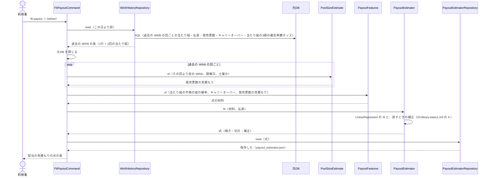
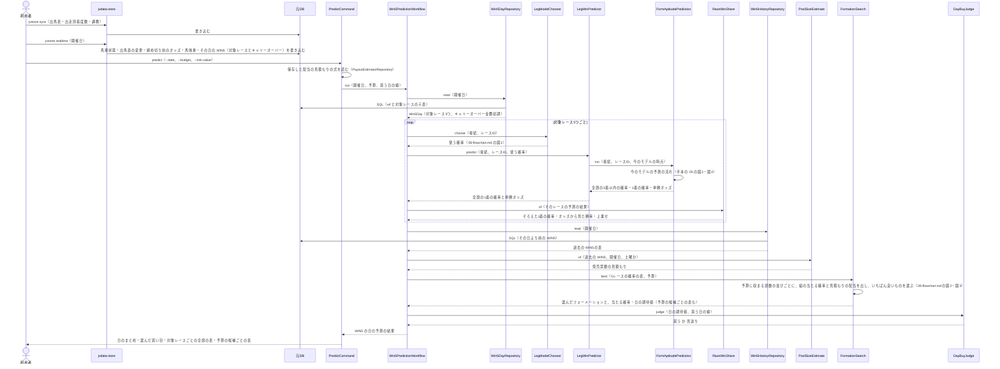

# 05 配当の見積もりの式と予測のやりとり（シーケンス図）

**この文書で示すこと:** 配当の見積もりの式を作るときと、WIN5 の日の予測のとき、利用者・jvdata-store・元DB と、[04-classes.md](04-classes.md) のクラスが、どの順に、どのメソッドを呼ぶか。

**結論: 流れは「配当の見積もりの式を作る」と「WIN5 の日の予測」の2つに分かれる。** この予想は機械学習のモデルを学ばないので、学習の流れは無い（1着の確率を出す今のモデルの学習は、手本の [05 の図1](../近走と適性から3着以内を予想/05-sequence.md#図1-学習)）。式は `FitPayoutCommand` が過去の WIN5 から作って保存する。予測は `Win5PredictionWorkflow` が進め、その日の WIN5 の対象レースを読み、**レースごとに今のモデルのどの時点を使うかを選んで1着の確率を出し、レースの中でそろえてから**、発売票数を見積もり、予算に収まるフォーメーションの中で見積もりの払戻がいちばん大きいものを選び、日の期待値で買うかどうかを決める。

- 図に出てくるものと、図の読み方（凡例）は [手本の 05 の「図に出てくるもの」](../近走と適性から3着以内を予想/05-sequence.md#図に出てくるもの) と [「図の読み方」](../近走と適性から3着以内を予想/05-sequence.md#図の読み方) を参照。この予想で増えるのは、[04-classes.md の「3.」](04-classes.md#3-この予想だけのクラスの一覧) のクラスと、`shared` に移す今のモデルの予測の流れ（`FormAptitudePrediction`）と時点の選び方（`TimingChooser`）、scikit-learn の `LinearRegression`（`fit()` か `predict()` を1回呼ぶ）、配当の見積もりの式のファイル（`payout_estimator.json`。`fit-payout` でできる）である。
- public メソッドの中の判断（if 文による分かれ道）は [06-flowchart.md](06-flowchart.md) を参照。2種類の図の使い分けは [01-overview.md](01-overview.md#図の使い分け) を参照。
- **今のモデルの中のやりとり（予測用データを作る・速報を反映する・2つのモデルで予測して平均する）は、手本とまったく同じである。** [手本の 05 の図2](../近走と適性から3着以内を予想/05-sequence.md#図2-予測)・[図4](../近走と適性から3着以内を予想/05-sequence.md#図4-1レースの記録を集める速報の反映) を参照。この文書では描き直さない。

## 図1. 配当の見積もりの式を作る

**説明。** 式は、`--before` の日より前の WIN5 だけで作る。過去の WIN5 での確かめでは、区切りごとに、そのテスト期間の始まりより前の回だけで作る（[11-leak-prevention.md の 8](11-leak-prevention.md#決まり)）。各回の発売票数は、その回の確定の値ではなく、その回より前の回から見積もった値を使う（予測のときと同じ作り方にするため）。

式は、新しい WIN5 の回がたまったら作り直す。作り直す間隔は、今のモデルの学び直しと同じく決めない（[16-evaluation.md の「今はしないこと」](16-evaluation.md#今はしないこと)）。

## 図2. WIN5 の日の予測

**説明。** 利用者は、まず jvdata-store の `jvstore sync` で出馬表などを取り込み、`jvstore realtime --date <開催日>` でその日の速報を取り込む。WIN5 の対象レースとキャリーオーバーは、速報の WIN5（`0B51`）で入る（下の「今は無く、これから作るところ」）。予測は、1レース目の締め切り前に1回行う（[07-prediction-timing.md](07-prediction-timing.md)）。実際には、道具「発走前の通知」が毎朝のタスクの中で、1レース目の発走の 10分前にこの取り込みと `predict` を行い、結果を投稿する（[15-decisions.md の 11](15-decisions.md#11-予想を届ける場所)）ので、利用者の作業は買うことだけになる。`predict` の結果は、実際の予想の記録として自動で保存する（`Win5ForecastRecordRepository`。[15-decisions.md の 7](15-decisions.md#7-締め切り時点のオッズと確定オッズの差の扱い)）。

`FormAptitudePrediction.run()` は、道具「今週の予想」がレースを予想するのと同じ組み立てで、今のモデルの学習済みモデル（`--form-models`）を読んで予測する。当日に券種のオッズが無ければ、今のモデルの券種オッズなしのモデルに切り替わる（手本の [06-flowchart.md の図3](../近走と適性から3着以内を予想/06-flowchart.md#図3-当日のモデルの選び方)）。この予想が使うのは、結果のうち1着の確率と単勝オッズだけである。障害のレースは、今のモデルで予測せず、オッズから見た勝率をそのまま使う（[15-decisions.md の 3](15-decisions.md#3-障害のレースが対象に入った日の扱い)）。

`FormationSearch.best()` が使う発売票数の見積もりは、その日より前の WIN5 だけから作る（[09-features.md の 2.](09-features.md#2-配当の見積もりに使う値)）。日の期待値が線に届かない日も、選んだ買い目と当たる確率は出す（予想は毎回出し、買うかどうかだけが変わる）。

## 今は無く、これから作るところ

2 は済んだ。ほかはまだ無い。作る順に並べる（前のものが無いと、あとのものを動かせない順）。

| 順 | 作るもの | 中身 |
|---|---|---|
| 1 | その日の WIN5（対象レースとキャリーオーバー）の取り込み | JV-Link の速報の WIN5（`0B51`。jvdata-store の [03-dataspecs.md](../../../../jvdata-store/docs/03-dataspecs.md) の速報系の表）を、jvdata-store の `jvstore realtime` が取り込む。元DB の `wf` には、今は終わった回（成績の月曜の版）しか入らない。取り込みは jvdata-store の仕事なので、やり方はこの設計書に書かない。2〜4 は、これが無くても過去の WIN5 で作って確かめられる |
| 2 | `shared` に移す部品（済み） | 今のモデルの予測の流れの組み立て・特徴量の一覧・時点の並び・時点の選び方・`--development-root` の引数を移し、今のモデルのパッケージと道具「今週の予想」も移した先を使う形に直した（[04-classes.md の 1.](04-classes.md#1-今のモデルの1着の確率の受け取り方)。材料を作る部品だけは `yosou.form_aptitude_materials`）。直したあと、今のモデルの予測と道具「今週の予想」の結果が前と同じになることを、元DB の過去のレース（木曜・前日・当日の時点）で確かめた |
| 3 | この予想のクラスとコマンド | `repository/`・`payout/`・`formation/`・`leg/`・`settlement/`・`workflow/`・`command/`（[04-classes.md の 3.](04-classes.md#3-この予想だけのクラスの一覧)）。テストは合成DB だけを使う |
| 4 | 道具「印の成績」の WIN5 の表（`--win5`） | 区切りごとの予測で、探索期間で買い方を選び、確認期間で1回だけ確かめる（[16-evaluation.md の 7.](16-evaluation.md#7-道具と全券種の回収率)）。選んだ並べ方・予算・線を `predict` の既定にする |
| 5 | 予想を毎回届けること | 道具「発走前の通知」に、WIN5 の日を読んで1レース目の発走の 10分前に `predict` を行い投稿する段を足し、開催日のまとめに WIN5 の節を足す（[15-decisions.md の 11](15-decisions.md#11-予想を届ける場所)） |
| 6 | ポリシー用の財布で買う計画 | 財布（`reports/回顧/財布.json`）と買う計画に WIN5 の分を足す。設計書「買うレースと買い目を決める」の財布の決まりにも書き足す（[15-decisions.md の 8](15-decisions.md#8-採用の基準に届かなかったときの扱い)） |

## 文書情報

| 項目 | 内容 |
|---|---|
| 作成日 | 2026-11-08 |
| 更新 | 2026-11-08: 15 の 3〜12 が決まり、「今は無く、これから作るところ」を作る順に並べた |
| 更新 | 2026-11-08: 15 の 1 が決まり、1着のモデルの学習の図を外して、配当の見積もりの式を作る図にした |
