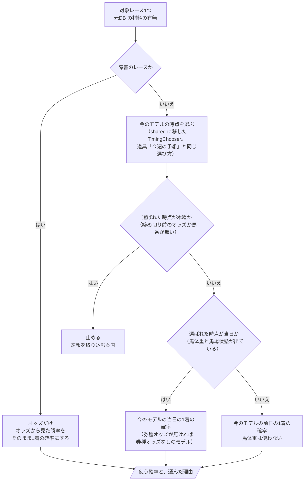
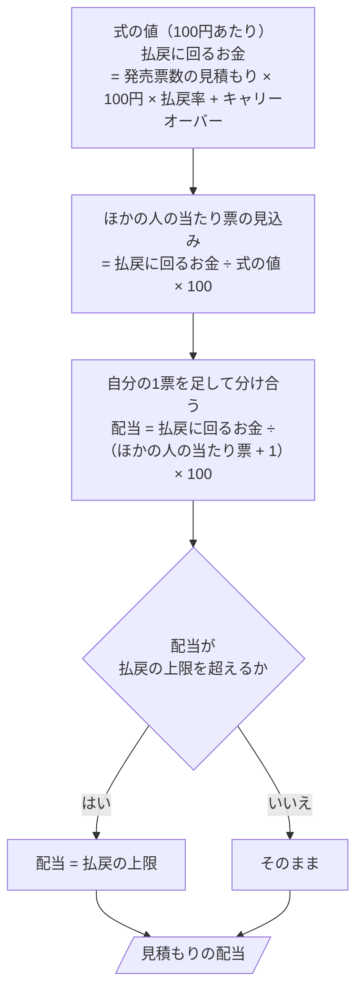
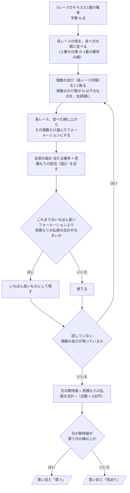

# 06 判断の手順（フローチャート）

**この文書で示すこと:** WIN5 の日の予測のときの、条件によって分かれる判断の手順。

**結論: この予想で増える、条件によって分かれる判断は3つある。「対象レースで使う確率の選び方」（図1）、「組1つの配当の見積もり」（図2。払戻の上限と自分の1票）、「買い目の組み方と買う日の判断」（図3）である。**

- この文書は、1つの public メソッドの中で、条件で分かれる判断の手順を示す。クラスどうしのやりとりは [05-sequence.md](05-sequence.md) を参照。2種類の図の使い分けは [01-overview.md](01-overview.md#図の使い分け) を参照。
- 図の読み方（凡例）は [手本の 06 の「図の読み方」](../近走と適性から3着以内を予想/06-flowchart.md#図の読み方) を参照。四角が作業、ひし形が if 文1つ、平行四辺形ができあがるものである。
- 今のモデルの中の判断（学習データに入れる行の選び方、予測に使うオッズの決め方、券種オッズの有無でのモデルの選び方）は、[手本の 06 の図1〜図3](../近走と適性から3着以内を予想/06-flowchart.md) を参照。
- 用語の意味は [02-glossary.md](02-glossary.md) を参照。

## 図1. 対象レースで使う確率の選び方

`LegModelChooser.choose()` の中の判断。WIN5 の対象レース1つについて、1レース目の締め切り前の時点で元DB に入っている材料から、今のモデルのどの時点の1着の確率を使うかを選ぶ。

**説明。** 平地のレースでは、道具「今週の予想」がレースごとに時点を選ぶのと同じ部品（`TimingChooser`。`shared` に移す）で時点を選ぶので、同じレースなら、週末の予想と同じ1着の確率になる。WIN5 の後ろのほうのレースは、1レース目の締め切りの時点で、まだ馬体重が出ていないことが多い。そのレースは今のモデルの前日の1着の確率（馬体重を使わない）を使う。券種のオッズが無いときに券種オッズなしのモデルに切り替える判断は、今のモデルの予測の流れの中で行われる（[手本の 06 の図3](../近走と適性から3着以内を予想/06-flowchart.md#図3-当日のモデルの選び方)）。

木曜になったときに止めるのは、木曜のモデルはオッズを使わず、配当の見積もりにも市場の組の確率（単勝オッズ）が要るためである。オッズの無いレースを1つでも含むと、その日の期待値を出せない。

障害のレースを「オッズだけ」にするのは、今のモデルが平地のレースだけで学んでいて、障害を予想の対象にしていないためである（[15-decisions.md の 3](15-decisions.md#3-障害のレースが対象に入った日の扱い)）。

## 図2. 組1つの配当の見積もり

`PayoutCeiling.apply()` の中の判断。配当の見積もりの式の値（`PayoutEstimator.estimate()` の戻り値。100円あたり）を、実際に払われうる配当に直す。

**説明。** 式は、過去の WIN5 で「当たった組の配当」を当てたものなので、ほかに当たる人がほとんどいない組（市場の組の確率がとても小さい組）では、配当が払戻に回るお金を超える値まで伸びる。実際には、自分が当てれば自分の票も当たり票に数えられ、払戻は分け合う形になる。そのため、ほかの人の当たり票の見込みに自分の1票を足して割る。ほかの人の当たり票が多い組（人気の組）では、自分の1票の影響はほとんど無い。

上限を超える分は払われず、次の回へのキャリーオーバーになる（[02-glossary.md の「払戻の上限」](02-glossary.md#win5-のルールの用語)）。

## 図3. 買い目の組み方と買う日の判断

`FormationSearch.best()` と `DayBuyJudge.judge()` の中の判断。5つの対象レースのそろえた1着の確率と、予算（点数）から、買い目と、買うかどうかを決める。

**説明。** 見積もりの払戻の合計（期待値 × 代金）で比べるので、予算を使い切るフォーメーションほど有利になる。点数の少ないフォーメーションは、払戻の合計が同じなら代金が少ない分だけ日の期待値が高いが、ここでは「予算の中で、いちばん多く戻る見込みの買い目」を選ぶ。予算の候補ごとに同じ探索をして表に並べ（[04-classes.md の「4.」](04-classes.md#4-コマンドの引数) の出す表 (4)）、どの予算を使うかは過去の WIN5 で決める（[16-evaluation.md の 4.](16-evaluation.md#4-買い目の組み方と買う日の線)）。

頭数の並びは、各レースの出走頭数を超えない、頭数のかけ算が予算以下のものを全部試す。各レース 18頭のとき、予算 100点で並びは約 6千、組は合わせて約 35万、予算 500点で並びは約 4万、組は合わせて約 1,100万になる。組の値は表の計算でまとめて出す（1組ずつ Python の for 文で回さない）。過去の WIN5 での確かめでは、これを数百日・予算の候補ごとに回すので、並べた順に上から選ぶ形（各レースの上位 k 頭の組は、上位 k−1 頭の組を含む）を使って、計算を使い回す。

## 文書情報

| 項目 | 内容 |
|---|---|
| 作成日 | 2026-11-08 |
| 更新 | 2026-11-08: 15 の 1 が決まり、図1 を今のモデルのどの時点の確率を使うかの選び方にした |
