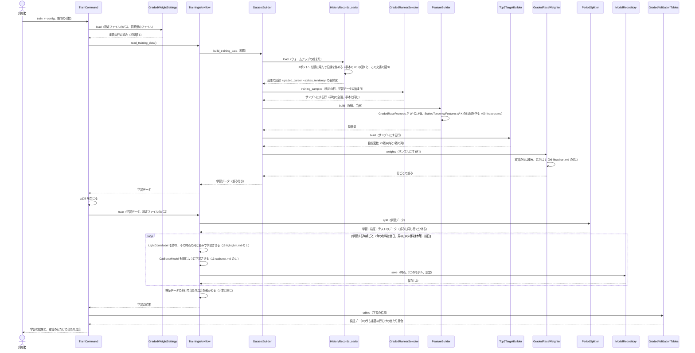
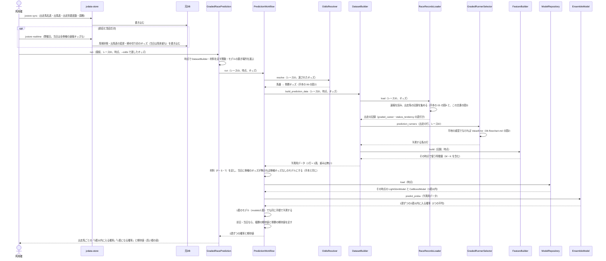
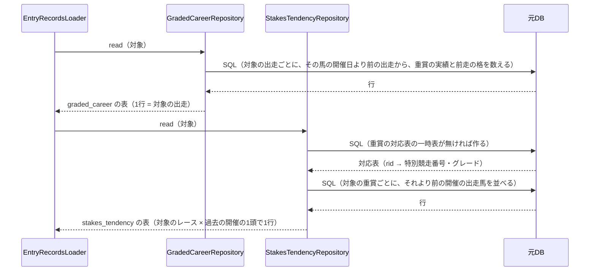

# 05 学習と予測のやりとり（シーケンス図）

**この文書で示すこと:** 学習と予測のとき、利用者・jvdata-store・元DB と、[04-classes.md](04-classes.md) のクラスが、どの順に、どのメソッドを呼ぶか。

**結論: 流れは「学習」と「予測」の2つに分かれ、手本の予想とほぼ同じである。** 学習は共通の `TrainingWorkflow` が進め、時点ごと・目的変数ごとに LightGBM と CatBoost を学習させて保存する。手本と違うのは、学習データに行の重み（`GradedRaceWeighter`）が付き、2つのモデルが重みを使って学ぶことと、記録を集めるときに重賞の材料を読む呼び出しが2つ増えること（図3）である。予測は `GradedRacePrediction` が組み立てた共通の `PredictionWorkflow` が進め、重賞でないレースはそこで止まる。

- 図に出てくるものと、図の読み方（凡例）は [手本の 05 の「図に出てくるもの」](../近走と適性から3着以内を予想/05-sequence.md#図に出てくるもの) と [「図の読み方」](../近走と適性から3着以内を予想/05-sequence.md#図の読み方) を参照。この予想で増えるのは、`GradedRaceWeighter`・`GradedRunnerSelector`・`GradedRaceFeatures`・`GradedRacePrediction`・`GradedCareerRepository` と、引退した予想から共通に移す `StakesTendencyRepository`・`StakesTendencyFeatures` である。
- public メソッドの中の判断（if 文による分かれ道）は [06-flowchart.md](06-flowchart.md) を参照。2種類の図の使い分けは [01-overview.md の「図の使い分け」](01-overview.md#図の使い分け) を参照。
- **リポジトリとのやりとりは、手本とほぼ同じである。** 学習データを集める流れは [手本の 05 の図3](../近走と適性から3着以内を予想/05-sequence.md#図3-記録を集めるリポジトリとのやりとり)、1レースの記録を集めて速報を反映する流れは [手本の 05 の図4](../近走と適性から3着以内を予想/05-sequence.md#図4-1レースの記録を集める速報の反映) を参照。この予想では、その並びの最後に、この文書の図3の呼び出しが2つ増える。

## 図1. 学習

1つの材料・1つの目的変数の学習。`train` は、手本と同じく、材料（馬の力の材料と今の材料）ごと・目的変数（3着以内と1着）ごとにこの流れを動かす。

**説明。** 利用者が `train` を実行すると、`TrainCommand` はまず `GradedWeightSettings` で重賞の行の重みを読み（[14-hyperparameter-settings.md](14-hyperparameter-settings.md)）、組み立ての関数（`graded_race_assembly.py`）に渡して `DatasetBuilder` を作る。学習データを作る順（記録を集める・入れる行を選ぶ・特徴量を作る・目的変数を付ける）は手本と同じで、最後に `GradedRaceWeighter` が行ごとの重みを付ける段が増える。入れる行は手本と同じく中央の平地の全頭で、重賞の行だけに重みが付く（[08-training-data.md](08-training-data.md)）。

手本と同じところ: 元DB は学習データを読む段だけ開く。1着のモデルは `WinTargetData` で目的変数と基準を持ち替えた学習データで学ぶ（重みは持ち越す）。当日の3着以内のモデルには `FinishPowerFreeData` で Q を外して渡す。木曜のモデルには展開の予想の結果（P）を足す。当日の券種オッズなしのモデルは `PoolFreeData` で N を外して学ぶ。モデルは、4つ（木曜・前日・当日・当日の券種オッズなし）× 目的変数2つ × LightGBM と CatBoost で 16個になる。

## 図2. 予測

木曜・前日・当日のどれかの時点で、1つの重賞を予測するときの流れ。

**説明。** 予測は手本の図2と同じ流れで、違うのは2つだけである。1つは、`GradedRunnerSelector.prediction_runners()` が、渡されたレースが平地の重賞でなければ止めること（このモデルは重賞を重く見て学んだもので、重賞の印と買い目に使うため。重賞でないレースは手本で予想する）。もう1つは、記録を集めるときに重賞の材料を読む2つの呼び出し（図3）が増えることである。予測用データに重みは付かない（重みは学習のときだけ使う）。予測に使うオッズの決め方と、要る情報が欠けているときの止め方は手本と同じである（[手本の 07 の「予測のときのオッズの与え方」](../近走と適性から3着以内を予想/07-prediction-timing.md#予測のときのオッズの与え方)）。

## 図3. 重賞の材料を読む

図1・図2の「リポジトリを順に呼んで記録を集める」（手本の 05 の図3・図4）の並びの最後に増える呼び出しを示す。学習でも予測でも同じで、違うのは「対象」（学習では期間内の全部の出走、予測では1レース）だけである。

**説明。** `GradedCareerRepository` はこの予想で足すリポジトリで、事実表の列（グレードコード・クラス名・確定着順・開催日）から、対象の出走ごとにその馬の過去の出走を数える。数えるのは開催日より前の出走だけである（[11-leak-prevention.md](11-leak-prevention.md#決まり) の 7）。`StakesTendencyRepository` は引退した予想のものをそのまま使い、SQL も `tools/共通/stakes.py` のままである（[引退した予想の 05 の図3](../重賞の傾向と近走から3着以内を予想/05-sequence.md#図3-重賞の傾向を読む)）。対象のうち重賞でないレースの行には、過去の開催の行が返らない（そのレースの K と、W の「同じ重賞の経験」は欠損値になる）。帯に分けて数える・同じ重賞の経験を引くのは SQL ではなく、`StakesTendencyFeatures`・`SameStakesHistory`（図1）で、学習と予測で同じクラスを通る。

## これから作るところ

| 図の中の部分・関係するもの | 今の状態 |
|---|---|
| `shared` に足す・変えるもの（`SampleWeighter`・`TrainingData` の重み・重みを渡す学習・`GradedCareerRepository`・`EntryRecords` の `graded_career`・ローダーの変更・K の部品の移し替え・`TrainPeriodArguments` の移し替え） | これから作る（[04-classes.md の 2](04-classes.md#2-shared-に足す変えるもの)） |
| この予想のパッケージ（`src/yosou/graded_race_top3_win/`） | これから作る（[04-classes.md の 4](04-classes.md#4-この予想だけのクラスの一覧)） |
| `StakesTendencyRepository` と SQL（`tools/共通/stakes.py`） | ある（引退した予想で作った） |
| 7つの区切りでの確かめ（研究「既存モデルの改善」の重賞の区切り `STAKES_WINDOWS`） | 区切りと比べ方の仕組みはある。この予想を学び直して予測を残す入口を足す（[16-evaluation.md の 4](16-evaluation.md#4-1年ずつの7つの区切りでの確かめ)） |
| 印と期待度の成績、印からの全券種の買い目の回収率（道具「印の成績」） | 道具はある。重賞だけに絞って、この予想の予測を読めるようにする（[16-evaluation.md の 5](16-evaluation.md#5-印と期待度の成績)） |
| 形の候補の数え上げと、券種の形・レースごとの券種の選び方を前半の年で選び、後半の年で確かめる入口 | これから作る。研究「重賞の買い方」の5回目として足す（[16-evaluation.md の 6](16-evaluation.md#6-印からの買い目の確かめ)） |
| 本番の買い方への入れ方（道具「今週の予想」・発走前の通知で、平地の重賞の確率をこの予想に替え、選んだ券種と形で買う。財布・金額） | **これから作る。** 買い方の設計書（[買うレースと買い目を決める](../買うレースと買い目を決める/01-overview.md)）の 03 の 4・07 の 5・08 の 2 を直す話で、16 の確かめで採用が決まってから行う。今の「3連単（重賞）」との関係は [15-decisions.md の 14](15-decisions.md#14-今の本番の3連単重賞との関係) で決める |
| 学習済みモデル（`reports/重賞に特化して3着以内と1着を予想/models/`） | `train` を実行すると作られる |

## 文書情報

| 項目 | 内容 |
|---|---|
| 作成日 | 2026-11-14 |
