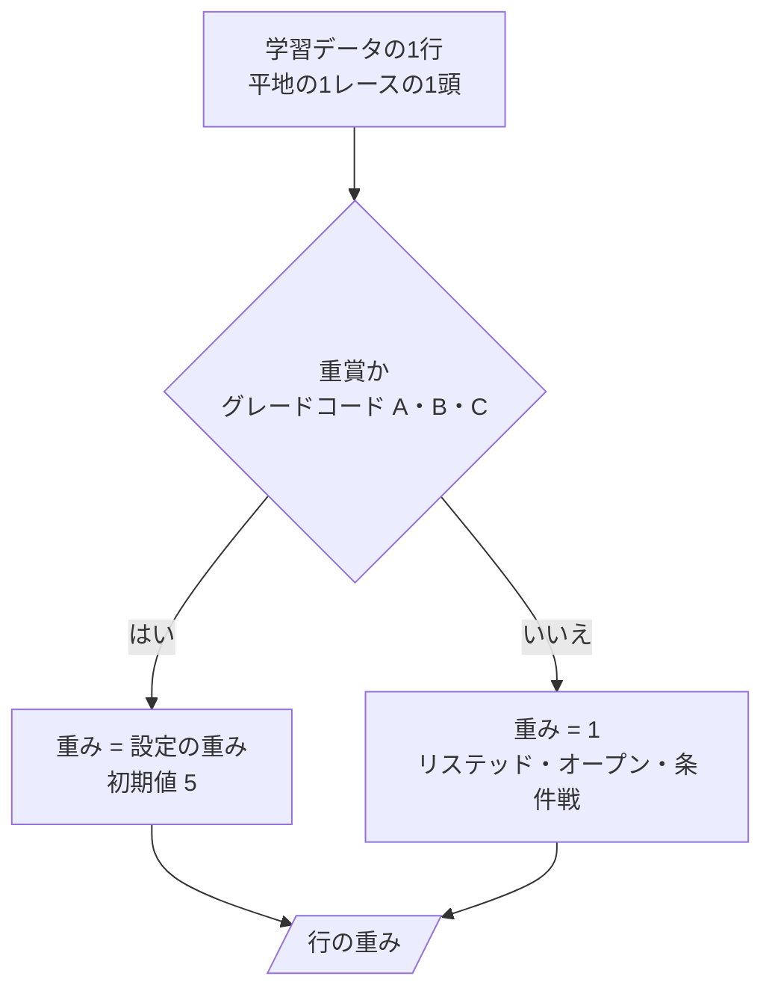
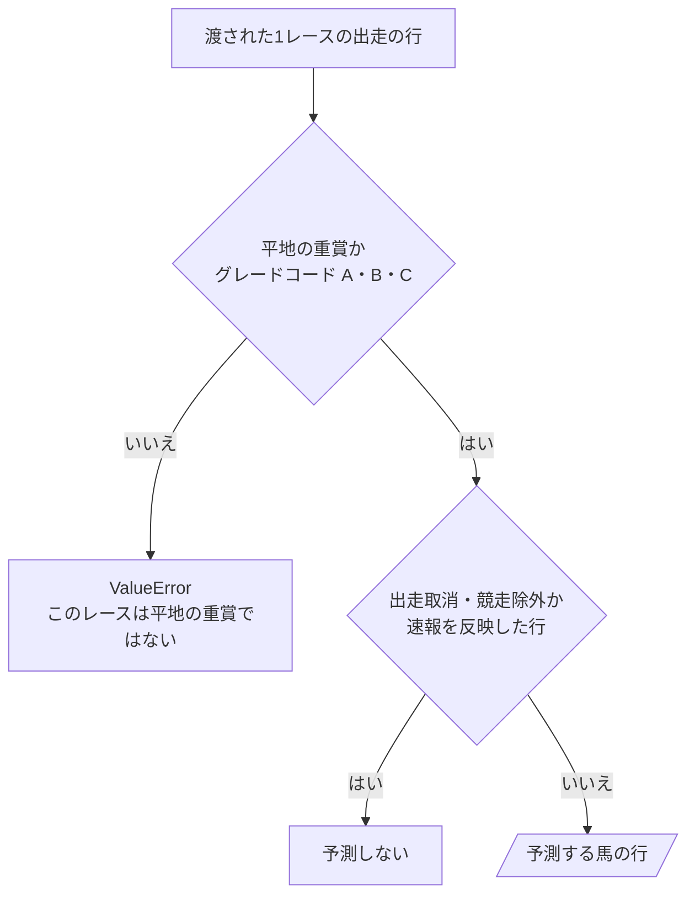
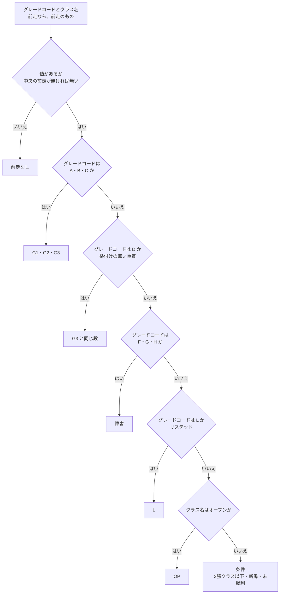

# 06 判断の手順（フローチャート）

**この文書で示すこと:** この予想で増える、条件によって分かれる判断の手順。

**結論: この予想で手本と違う判断は3つである。学習データの行の重みの決め方（図1）、予測する馬の行の選び方（図2。重賞でなければ止める）、格の名前の決め方（図3）。学習データに入れる行の選び方・予測に使うオッズの決め方・当日のモデルの選び方は手本と同じなので、描き直さない。**

- この文書は、1つの public メソッドの中で、条件で分かれる判断の手順を示す。クラスどうしのやりとりは [05-sequence.md](05-sequence.md) を参照。2種類の図の使い分けは [01-overview.md の「図の使い分け」](01-overview.md#図の使い分け) を参照。
- 図の読み方（凡例）は [手本の 06 の「図の読み方」](../近走と適性から3着以内を予想/06-flowchart.md#図の読み方) を参照。
- 学習データに入れる行の選び方（`GradedRunnerSelector.training_samples()` は共通の `RunnerSelector` と同じ）は [手本の 06 の図1](../近走と適性から3着以内を予想/06-flowchart.md#図1-学習データに入れる行の選び方)、予測に使うオッズの決め方は [手本の 06 の図2](../近走と適性から3着以内を予想/06-flowchart.md#図2-予測に使うオッズの決め方)、当日のモデルの選び方は [手本の 06 の図3](../近走と適性から3着以内を予想/06-flowchart.md#図3-当日のモデルの選び方) をそのまま使う。
- 用語の意味は [02-glossary.md](02-glossary.md) を参照。

## 図1. 学習データの行の重みの決め方

`GradedRaceWeighter.weights()`（共通の `DatasetBuilder.build_training_data()` から呼ばれる）の中で行う判断。学習データの1行（手本の図1で選ばれた、平地の1レースの1頭）に、重みを1つ付ける。

**説明。** 重賞かどうかは `GradeLadder.is_graded()` が答える（重み・予測の絞り込み・特徴量の「重賞か」で同じ決まりを使う。[04-classes.md の 1](04-classes.md#1-共通の部品とこの予想だけの部品の分け方)）。障害の重賞（グレードコード F・G・H）は、手本の図1の「障害レースか」で学習データから外れているので、ここには来ない。

- 学習・検証・テストの行のどれにも、同じ決まりで重みを付ける（検証データの重みは早期終了に使う。[12-lightgbm.md の 1](12-lightgbm.md#1-学習データの渡し方)）。
- 重みは目的変数（3着以内・1着）に依らない。重賞の行の中の 1 と 0 の割合は変わらない（[10-target.md](10-target.md#1-と-0-の数の偏り)）。
- 設定の重みは `[sample_weight]` の `graded_race`（[14-hyperparameter-settings.md](14-hyperparameter-settings.md)）。重みを 1 にすると、手本と同じ重みで学ぶ（16 の比べで使う）。

## 図2. 予測する馬の行の選び方

`GradedRunnerSelector.prediction_runners()`（共通の `DatasetBuilder.build_prediction_data()` から呼ばれる）の中で行う判断。渡された1レースの出走の行から、予測する馬の行を選ぶ。

**説明。** 1つ目の問いがこの予想で増える。重賞でないレースは黙って空を返さずに止め、コマンドが「エラー: このレースは平地の重賞（G1・G2・G3）ではない」の1行で見せる。このモデルは重賞の行を重く見て学んだもので、重賞の印と買い目に使うためである（重賞でないレースは手本で予想する）。2つ目の問いは手本と同じで、共通の `RunnerSelector.prediction_runners()` に任せる（図では、どの馬の行を残すかが分かるように描いた）。

## 図3. 格の名前の決め方

`GradeLadder.name_of()` の中で行う判断。今回のレースの格（まとまり W の「格」）と、前走の格（「前走の格」）の両方に使う。前走の格では、前走が無い馬（DB に中央の前走が無い）にも名前を付ける。

**説明。** 格の段（条件 1・OP 2・L 3・G3 4・G2 5・G1 6）は `GradeLadder.step_of()` が名前から返す。「前走なし」と「障害」には段を付けない（欠損値）。今回のレースは平地なので、「前走なし」と「障害」にはならない。

- 格付けの無い重賞（D）は、DB の 2011年以降の平地ではほとんど無いので、G3 と同じ段に置く（名前も G3）。カテゴリの値を1つ増やしても、学ぶ行がほとんど無いためである。
- クラス名は事実表の `class_name`（`tools/共通/facts.py`。競走条件コードとグレードコードから付けたもの）を使う。手本のまとまり A の「クラス」（数値）と同じ元である。

## 文書情報

| 項目 | 内容 |
|---|---|
| 作成日 | 2026-11-14 |
