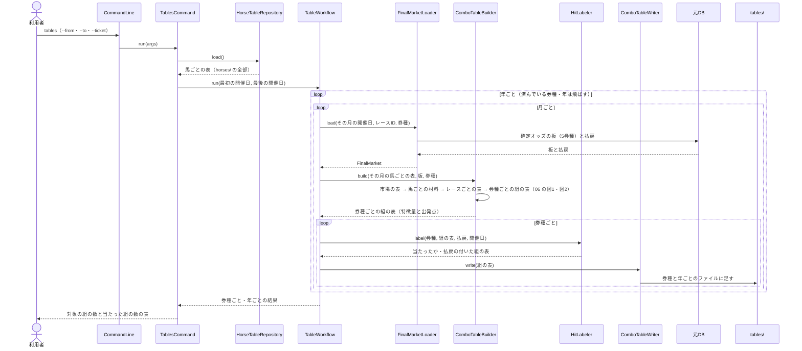
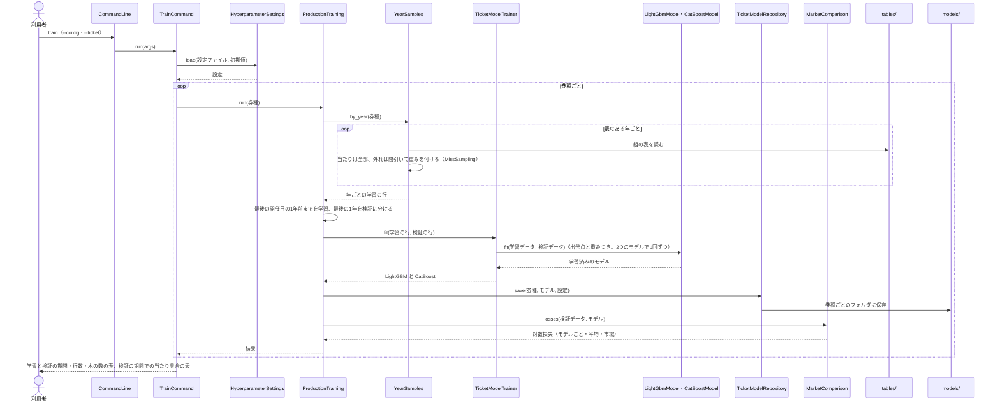
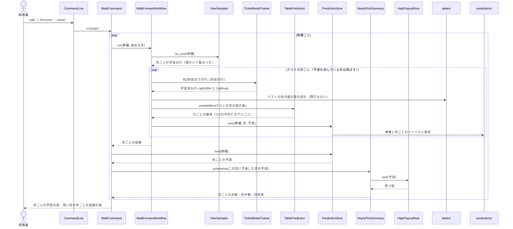
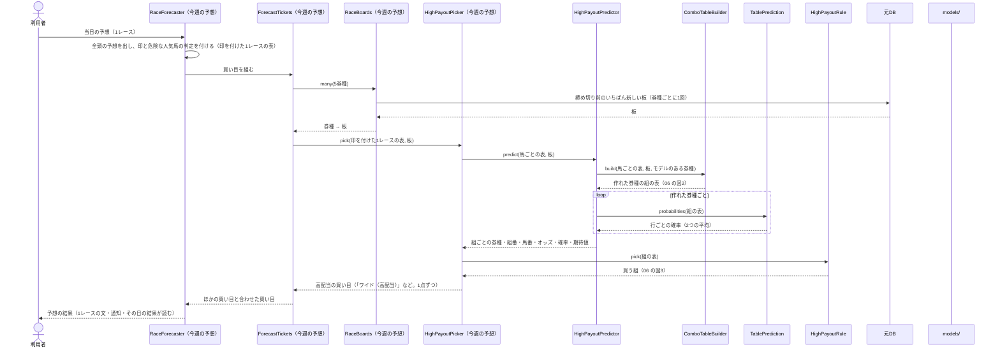

# 05 学習と予測のやりとり（シーケンス図）

**この文書で示すこと:** 組の表づくり・学習・年ごとの確かめ・1レースの予測のとき、利用者・元DB と、[04-classes.md](04-classes.md) のクラスが、どの順に、どのメソッドを呼ぶか。

**結論: 流れは4つに分かれる。** 組の表づくり（`tables`。図1）は `TableWorkflow` が進め、月ごとに元DB の確定オッズの板と払戻を読んで、組の表を年ごとのファイルに書く。本番のモデルの学習（`train`。図2）は `ProductionTraining` が、年ごとの学習と予測（`walk`。図3）は `WalkForwardWorkflow` が進め、どちらも保存した組の表だけから学ぶ（元DB を開かない）。1レースの予測と買い目（図4）は、今週の予想の当日の予想が `HighPayoutPredictor` と `HighPayoutRule` を呼んで行う。組の表を作る `ComboTableBuilder` は、図1 と図4 の両方に出てくる。

- public メソッドの中の判断（if 文による分かれ道）は [06-flowchart.md](06-flowchart.md) を参照。
- 図の読み方（凡例）は [手本の 05 の「図の読み方」](../近走と適性から3着以内を予想/05-sequence.md#図の読み方) を参照。
- 用語の意味は [02-glossary.md](02-glossary.md) を参照。

## 図に出てくるもの

| 名前 | 種類 | 呼ばれ方 |
|---|---|---|
| 利用者 | 人 | ― |
| 元DB | jvdata-store が作った DuckDB。この予想は読むだけ | 共有のリポジトリが SQL を1回流す |
| `TableWorkflow` など | この予想のクラス。一覧と仕事は [04-classes.md](04-classes.md#2-この予想だけのクラス) | public メソッドを1回呼ぶ |
| `LightGbmModel`・`CatBoostModel`・`EnsembleModel` | 共有のモデルのクラス | `fit()` か `predict_proba()` を1回呼ぶ（中のやりとりは [12-lightgbm.md](12-lightgbm.md)・[13-catboost.md](13-catboost.md)） |
| `horses/`・`tables/`・`predictions/`・`models/` | `reports/高配当の組が当たるかを予想/` の下のファイル | 1回書き込むか、1回読み込む |
| `RaceForecaster`・`ForecastTickets`・`HighPayoutPicker`・`RaceBoards` | 道具「今週の予想」のクラス（`tools/今週の予想/`） | public メソッドを1回呼ぶ |

## 図1. 組の表を作る

説明。元DB は、月ごとに板と払戻を読む間だけ開く。特徴量を作っている間は閉じているので、ほかの道具を待たせない。3連単は1年で数百万行になるので、月ごとに作って年のファイルに足し、1年ぶんをメモリに持たない。書いている途中のファイルは別の名前にしておき、書き終えてから名前を直す。途中で止まった年が、済んだ年に見えないようにするためである。`ComboTableBuilder.build()` の中で呼ぶクラス（`MarketTableBuilder`・`HorseMaterials`・`RaceMaterials`・`TicketTableAssembler` と `feature/` の各クラス）は [04-classes.md](04-classes.md#dataset--組の表を作る) を、表に入れる組の選び方は [06-flowchart.md の図1](06-flowchart.md#図1-表に入れる組の選び方) を参照。

## 図2. 学習

本番のモデルの学習（`train`）。

説明。学習は、保存した組の表だけから行う（元DB を開かない）。1年ぶんの表を読んでは間引くので、メモリに残るのは間引いた行だけである。学習データへの詰め替え（特徴量・目的変数・出発点・行の重み）は `ModelDataFactory` が行い、`TicketModelTrainer` が呼ぶ。検証の期間での当たり具合は、木の数を決めるのに使った行で測るので目安である（[16-evaluation.md の 8](16-evaluation.md#8-本番のモデルの学習)）。

## 図3. 年ごとの学習と予測

確かめ用（`walk`）。テストの年ごとに学び直す。

説明。どの年の予測も、その年より前のレースだけで学んだモデルが出す（[11-leak-prevention.md](11-leak-prevention.md#決まり) の 5）。テストの年の行は間引かずに全部を予測し、保存する。保存した予測は、道具「高配当の買い目」の `stats.py` が読んで、期間ごとの成績と 90% の幅、運用の目安を出す（[16-evaluation.md の 4](16-evaluation.md#4-年ごとの確かめ)）。`walk` が出す年ごとの成績は、その場で見るための簡単な表である。予測の済んでいる年は学び直さないので、途中で止まっても続きの年から再開できる（`--force` を付けると、済んでいる年も学び直す）。

## 図4. 1レースの予測と買い目

本番。今週の予想の当日の予想の中で行う。

説明。学習済みのモデルは、`HighPayoutPicker` を作るときに1回だけ読む（`HighPayoutPredictor.load()`。図では省いた）。モデルの置き場所が無ければ、高配当の買い目は作らない。馬ごとの表は、印を付けた1レースの表から、この予想に要る列だけを取り出したものである。板が足りない券種・モデルの無い券種は、組を返さないので 0点になる（誤りにしない）。本番で出す券種と上限の点数は、道具の側の定数（`tools/今週の予想/ticket_rules.py` の `HIGH_PAYOUT_TICKET_TYPES`・`HIGH_PAYOUT_MAX_POINTS`）で決める（[15-decisions.md の 15・16](15-decisions.md#15-本番で出す券種)）。評価できない馬（データの無い招待馬）を含む組は、道具の側で外す。買い目の見せ方と、財布に入れないことは [買うレースと買い目を決める の 08 の 2](../買うレースと買い目を決める/08-bankroll-and-review.md#高配当の買い目) を参照。

## 今は無く、これから作るところ

無い。締め切り前の5券種のオッズは、jvdata-store がすでに取っている（速報のオッズ）。

## 文書情報

| 項目 | 内容 |
|---|---|
| 作成日 | 2026-11-24 |
