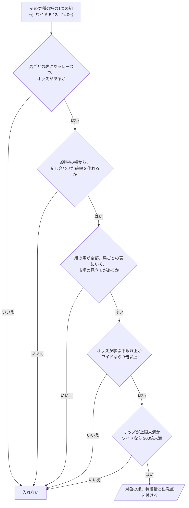
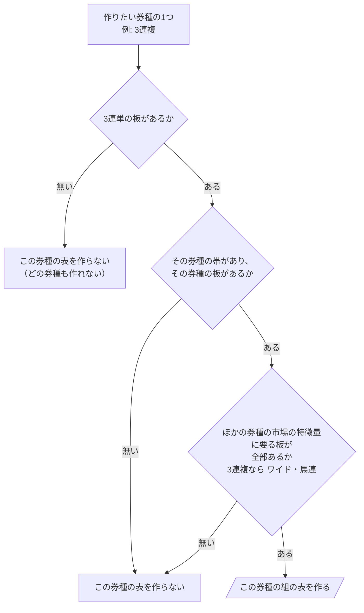
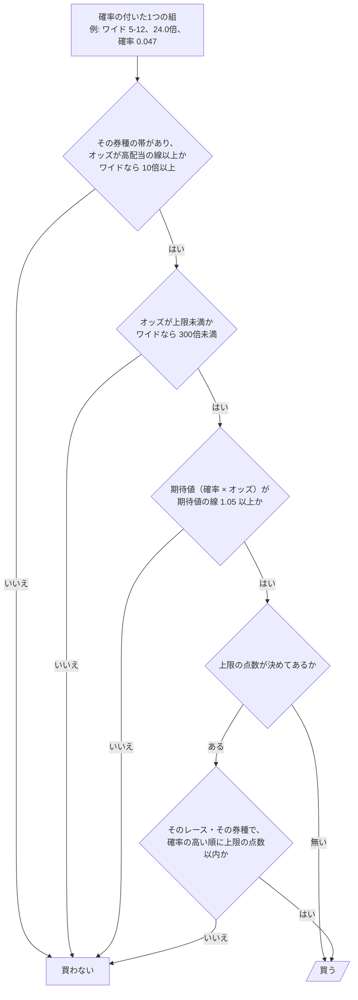

# 06 判断の手順（フローチャート）

**この文書で示すこと:** 組の表を作るとき・買い目を選ぶときの、条件によって分かれる判断の手順。

**結論: この予想だけの判断は3つある。「どの組を表に入れるか」（図1。`MarketTableBuilder.build()` と `TicketTableAssembler.table()`）、「板が足りない券種をどう扱うか」（図2。`ComboTableBuilder.build()`）、「どの組を買うか」（図3。`HighPayoutRule.pick()`）である。** 外れの組の間引き（`MissSampling.sample()`）は、「当たりか、くじに当たった外れか」の1つの判断だけなので、図にしない（[08-training-data.md](08-training-data.md#4-外れの組の間引きと行の重み)）。

- クラスどうしのやりとりは [05-sequence.md](05-sequence.md) を参照。
- 図の読み方（凡例）は [手本の 06 の「図の読み方」](../近走と適性から3着以内を予想/06-flowchart.md#図の読み方) を参照。
- 用語の意味は [02-glossary.md](02-glossary.md) を参照。

## 図1. 表に入れる組の選び方

組の表に入れる行（対象の組）の選び方。前半の3つの判断は `MarketTableBuilder.build()`、後半の2つは `TicketTableAssembler.table()` の中にある。学習用の表づくりでも、本番の1レースの予測でも、同じ手順を通る。

**説明。** 学ぶ下限と上限は、券種ごとの帯（`PayoutBand.is_learnable()`）で決まる（[10-target.md](10-target.md#オッズの帯)）。高配当の線は、ここでは見ない。線より下の組も学習と予測の対象にし、買うときに線以上だけを選ぶ（図3）。組の馬が馬ごとの表にいるかは、`TicketTableAssembler.table()` でも、馬ごとの材料を引くときにもう一度確かめる。上限以上で入れなかった組も、レースの材料の「学ぶ下限以上の組の数・市場の確率の合計」（`reg_n`・`reg_q`）には数える（[09-features.md](09-features.md#f-レースの材料)）。

## 図2. 板が足りない券種の扱い

`ComboTableBuilder.build()` が、券種ごとに「この券種の表を作れるか」を決める判断。本番の予測では、締め切り前の板がまだ無い券種があるので、誤りにせず、作れる券種だけを返す。

**説明。** 3連単の板は、どの券種にも要る。3連単から足し合わせた確率（`log_t`）と、馬ごとの3連単の支持（`psup`）を作るためである。ほかの券種の市場の特徴量に要る板は、券種ごとに決まっている（[09-features.md](09-features.md#b-ほかの券種の市場)）。作らなかった券種は、戻り値に入らない。予測の入口（`HighPayoutPredictor.predict()`）は、その券種の組を返さず、買い目は 0点になる。学習済みのモデルが無い券種も、同じく組を返さない。

## 図3. 買い目の選び方

`HighPayoutRule.pick()` が、確率の付いた組の1つずつについて、買うかどうかを決める判断。本番の1レースの予測にも、年ごとの確かめの成績の数え上げにも、同じ決まりを使う。

**説明。** 例の組は、24.0倍で高配当の線（10倍）以上・上限（300倍）未満、期待値は 0.047 × 24.0 = 1.13 で線以上なので、買う。帯と期待値の線の既定は `DEFAULT_BANDS`・`DEFAULT_VALUE_LINE`、上限の点数の既定は「無し」である。上限の点数を置くかどうかは、まだ決まっていない（[15-decisions.md の 16](15-decisions.md#16-1レース1券種の上限の点数)）。この決まりは金額を持たない。1点 100円で数えるのは、この予想を使う道具の側である。

## 文書情報

| 項目 | 内容 |
|---|---|
| 作成日 | 2026-11-24 |
| 例の値 | すべて架空。JV-Data の実際の値は載せていない |
